<p align="center">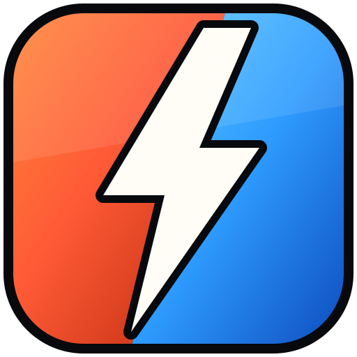</p>

# Sim Clash

**Arcade 1v1 golf for real launch monitors.** Two players, one bay, real swings. Free and
open source.

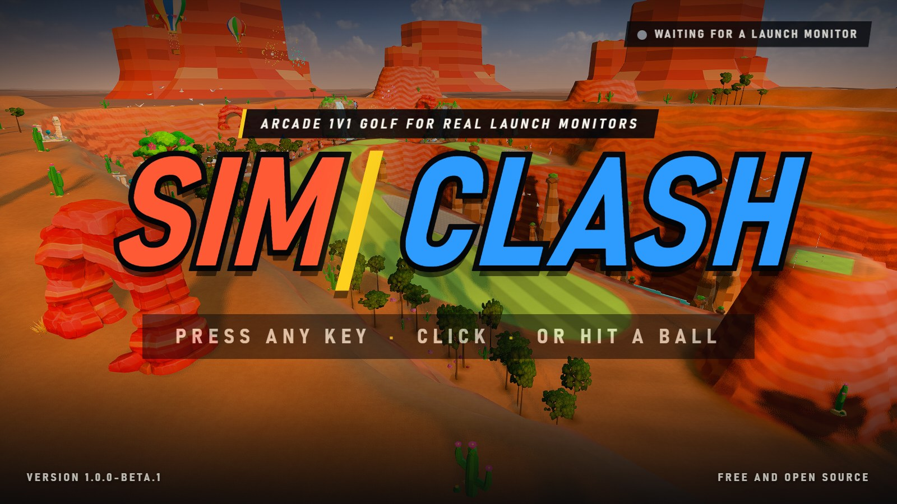

Sim Clash is a video game you play with a real golf club. You hit a real ball into your
simulator screen or net, your launch monitor measures it, and the game does the rest: a
head-to-head match on fantasy holes, with power-up balls, tricks to play on your opponent,
a crowd, an announcer, and sudden death when a hole is tied. It is built to be loud, quick
and friendly to a bad swing. It is not a golf simulator: there are no real courses in it.

- **Status:** beta (`1.0.0-beta.1`). Windows. It has been played on one simulator bay so
  far; reports from other launch monitors are very welcome.
- **Price:** nothing. No account, no real money, nothing to buy.
- **Licence:** MIT. Built on [Open-Birdie](#built-on-open-birdie).

## What is in it

- **Versus on one bay.** Two players take turns at the same simulator. Quick match (one
  hole), best of 3, or a best-of-9 tournament.
- **15 stages.** Twelve match holes, each its own world (a lagoon, a canyon, a volcano
  crater, an ice ridge, a cherry-blossom garden, a temple, a desert gate, a neon city at
  midnight and more) and three sudden-death arenas. Three of the twelve are "rocket holes"
  of 400 to 700 yards, played with a free rocket ball off the tee.
- **Knockout rules.** A hole ends the moment one player cannot tie it. A tied hole goes
  straight to sudden death: one ball each, closest to the pin.
- **15 power-up balls and 3 tricks.** Rocket, Sticky, Magnet, Ghost, Skipper, Fireball and
  the rest change what your ball does; Gust, Tiny Cup and Fog are played on your opponent's
  next swing.
- **Every shot gets a verdict.** Graded from the launch data, with a callout banner, points,
  coins, streaks and a crowd that rises as the ball tracks at the hole.
- **A ball cam** that flies with the ball and cuts to the pin to watch it arrive.
- **An announcer and a full sound pack**, all short one-shots. Nothing loops and there is no
  shot clock: take your time over a real ball.
- **Easy putting on purpose.** Launch monitors read putts poorly, so the game reads the
  green for you. A putt needs pace more than line.
- **Solo**: a tour of 3, 6 or all 12 stages against your own best score, or any single
  stage. **Practice**: free play, closest to the pin, a putting challenge, up and down.
- **Test swings** from the mouse when no launch monitor is connected, so anyone can try it.

## Screenshots

| | |
| --- | --- |
| 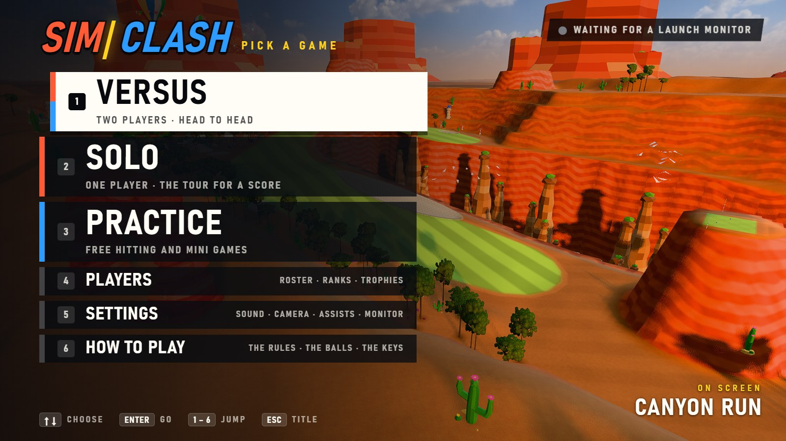 The main menu | 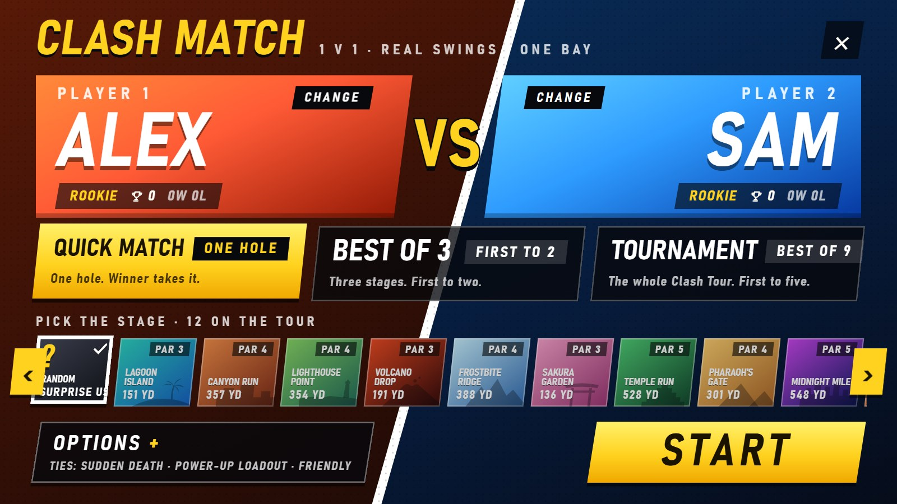 The match lobby |
| 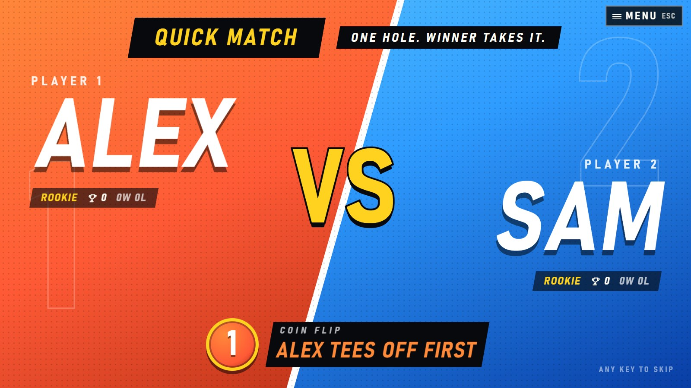 The coin flip | 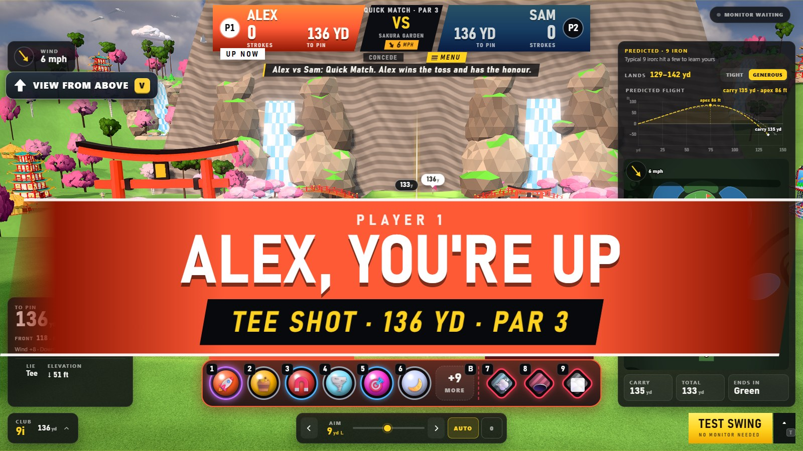 Called to the tee |
| 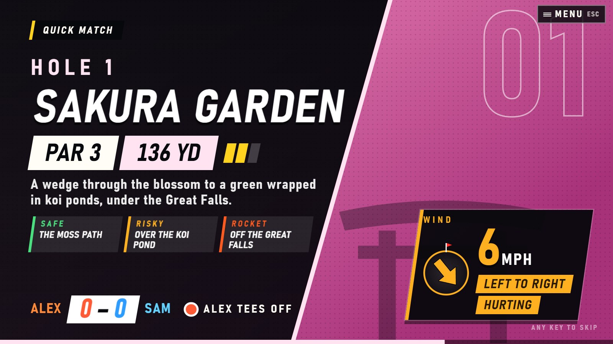 A stage introduces itself | 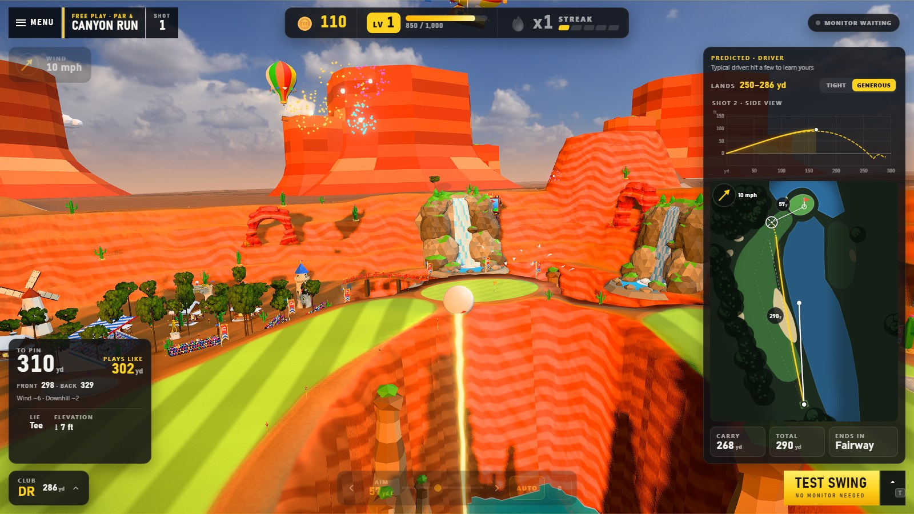 The ball cam in flight |
| 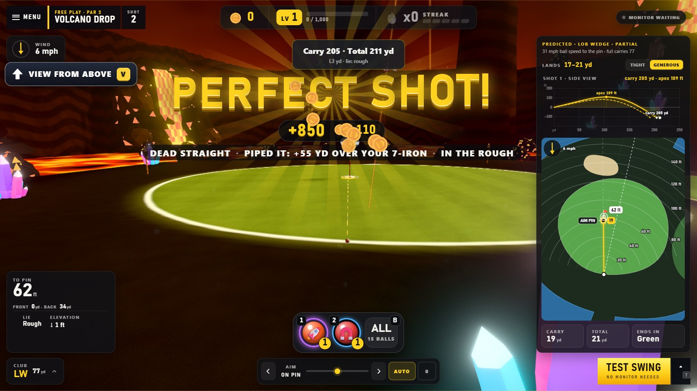 Every shot gets a verdict | 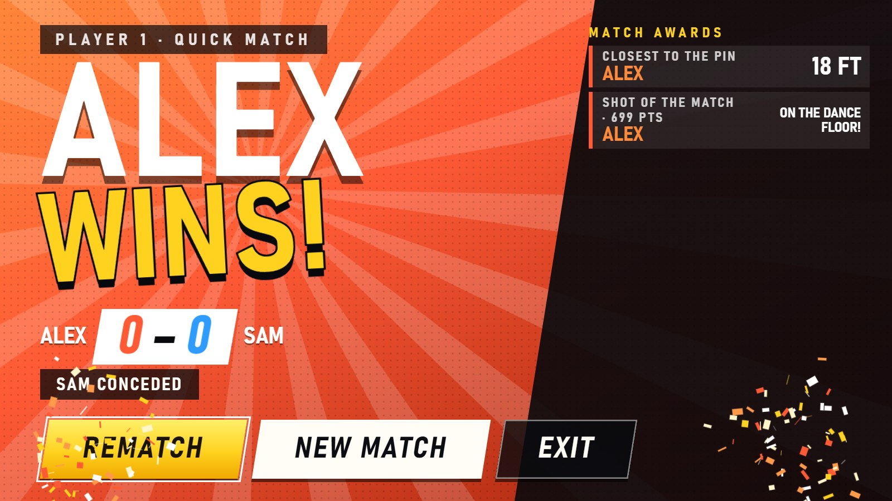 The winner screen |
| 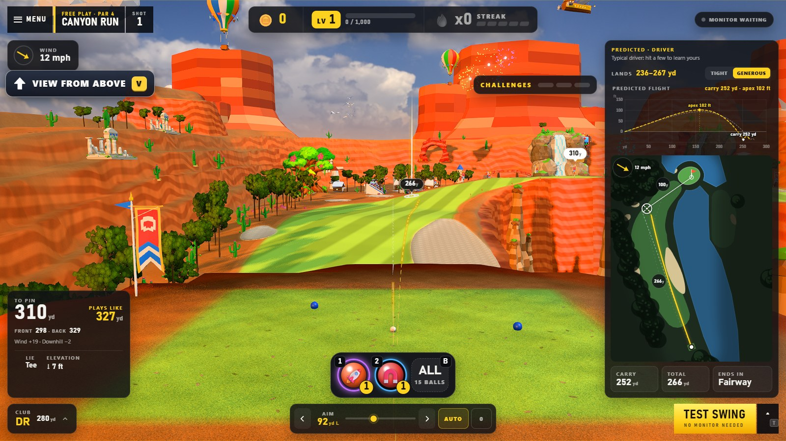 Canyon Run | 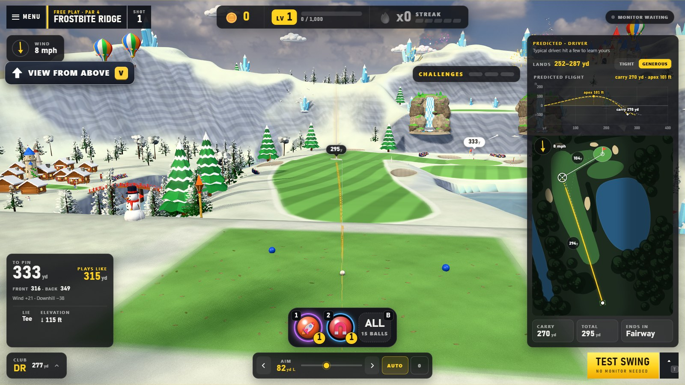 Frostbite Ridge |
| 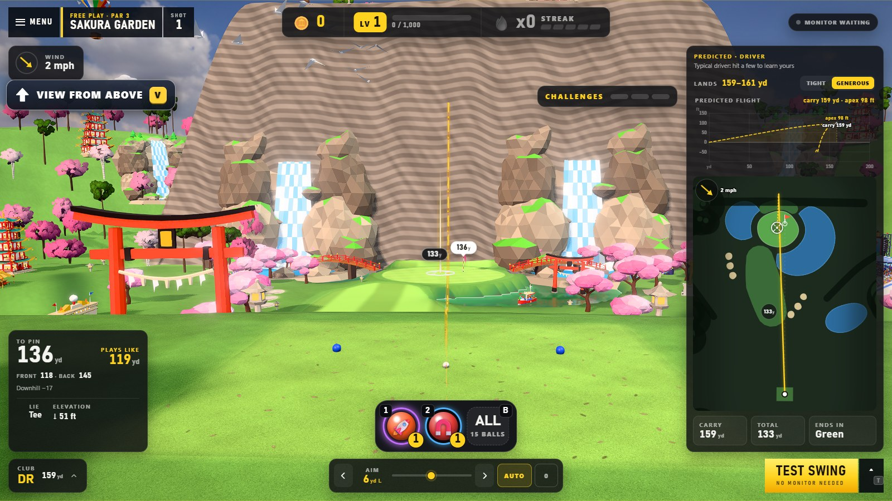 Sakura Garden | 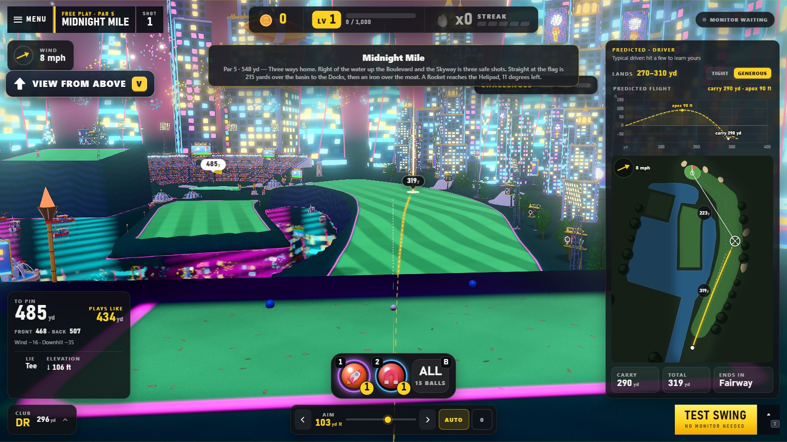 Midnight Mile |
| 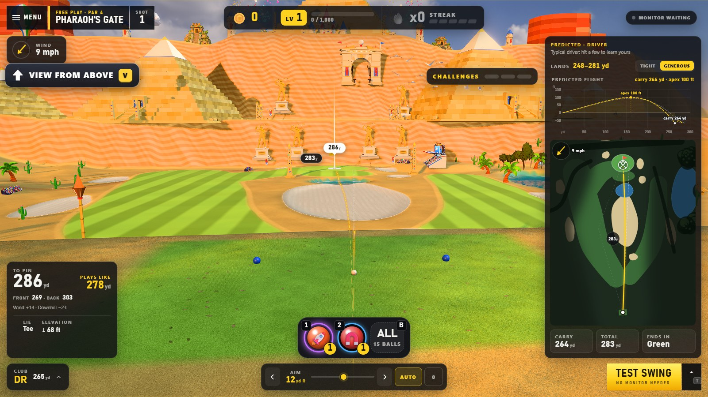 Pharaoh's Gate | 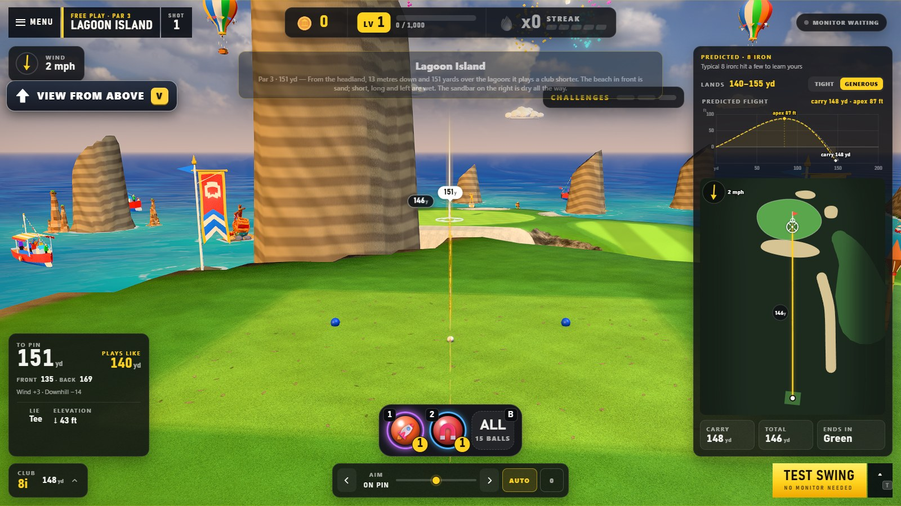 Lagoon Island |
| 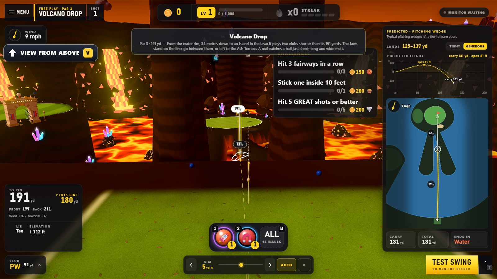 Volcano Drop | 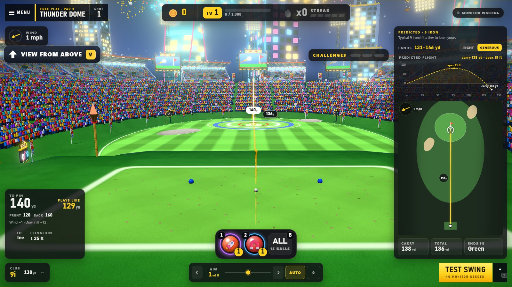 Thunder Dome, a sudden-death arena |

## Install (Windows)

1. Download `Sim-Clash-Setup-<version>.exe` from the
   [Releases page](../../releases).
2. Run it. One click: it installs for your Windows user only (no administrator prompt),
   adds a desktop and a Start-menu shortcut called **Sim Clash**, and starts the game.
3. The game opens full screen on your main display. **F11** or **Alt+Enter** switches
   between full screen and a window, and it remembers which you left it in.

Two things Windows will ask the first time:

- **"Windows protected your PC" (SmartScreen).** The installer is not code-signed yet, so
  Windows does not know who published it. Choose **More info**, then **Run anyway**. If
  you would rather not, [run it from source](#run-from-source): it is the same game. (On a
  Windows 11 PC with **Smart App Control** switched on, unsigned apps are blocked with no
  "Run anyway": running from source is the way there too.) Each release lists the
  installer's SHA-256 checksum so you can check your download.
- **Windows Firewall.** The game listens for your launch monitor on TCP port 921, on every
  network interface, so Windows asks whether to allow it. If your launch monitor's
  connector software runs on this same PC, you can refuse: local connections still work.
  If the connector runs on another device, allow **private networks** only. (The
  experimental Foresight bridge uses a second port, 9050, on this PC only. Windows does not
  normally ask about that one.)

Sim Clash keeps its settings, players and coins in `%APPDATA%\Sim Clash`. It installs
beside Open-Birdie without touching it, but the two cannot run at the same time (they use
the same ports).

To remove it: Windows Settings, Apps, **Sim Clash**, Uninstall. Your players, coins and
settings are left in `%APPDATA%\Sim Clash`; delete that folder too if you want them gone.

The game works offline and makes no network requests of its own: the stages and the sky
photos they are lit by are installed with it. The one exception is yours to switch on: with
your own ElevenLabs key it fetches [spoken player names](docs/arcade-voice.md).

## Run from source

You need [Node.js](https://nodejs.org) 22 or newer and Git.

```
git clone https://github.com/robertjackson-engage/sim-clash.git
cd sim-clash
npm install
npm start
```

On Windows you can double-click `Sim Clash.bat` instead of the last two lines. `npm start`
builds the 15 stages (a few seconds), fetches the two sky photos the stages are lit by the
first time (33 MB, CC0, from Poly Haven, checked against pinned checksums; without a
connection the game starts anyway and those stages use the midday sky) and opens the game
full screen. **F11** leaves full screen. `Open-Birdie.bat` starts the original simulator
instead.

Other ways to run it:

| Command | What |
| --- | --- |
| `npm run start:server` | the game server without a window; open `http://localhost:8222` in a browser |
| `npm test` | the test suite (Node 22 or newer) |
| `npm run pack` | build the unpacked Windows app into `dist/win-unpacked` |
| `npm run prepare:sky` | fetch (or find on this PC) the sky photos the stages use, into `build/arcade-data/sky` |
| `npm run dist` | build the Windows installer into `dist/` and check it |

## Connect a launch monitor

The first time you start the game it walks you through connecting your launch monitor. The
short version:

Sim Clash speaks **GSPro Open Connect v1**: it listens on **TCP port 921** and plays the
part GSPro's "Open API" plays. A connector that sends its shots to GSPro's Open API, and
has no other tie to GSPro, can send them to Sim Clash instead when GSPro is closed.

**That is fewer launch monitors than "anything that works with GSPro".** GSPro reaches
most launch monitors (Uneekor, FlightScope, Garmin, Rapsodo, Full Swing, Square, ProTee and
others) through connections built into its own connector program. Those do not use the Open
API and cannot be pointed at another program, so choosing "GSPro" in your launch monitor's
software is usually not enough. What can feed this game:

- a maker's own Open API client (Square's SQG GSPro Connect, NVisage's N-Connect and a few
  more);
- the open-source launch monitors (PiTrac, OpenFlight), which send Open Connect themselves;
- community connectors: unofficial helper programs that read a launch monitor and send
  Open Connect to an address you type;
- Foresight GC units, through the Foresight bridge built into the game (below).

For a connector of the first three kinds:

1. **Close GSPro and any other simulator software.** Only one program can own port 921.
2. Start Sim Clash.
3. Start the connector and give it the address `127.0.0.1` (it runs on this PC) or this
   PC's network address, port `921`.
4. The chip at the top right changes from **Monitor waiting** to **Monitor connected**.
   Hit a ball.

**Which launch monitors?** Every one we know about is below, in four tiers. How each one
connects, with the source for every claim, is in
[docs/launch-monitors.md](docs/launch-monitors.md). The table, that document, the website
and the in-game connection wizard are all generated from one catalogue
(`lib/launch-monitors.json`), so they never disagree. Nothing is called tested unless a
ball has been hit with it on a real rig: today that is one unit.

<!-- launch-monitors:start (filled from lib/launch-monitors.json by: node tools/release/readme-monitors.cjs) -->
| Tier | What it means | Launch monitors |
| --- | --- | --- |
| **Tested** (1) | Works on a real rig. | Foresight GCQuad |
| **Expected to work** (8) | Its own connector is documented to send Open Connect, or it is the same connector as a tested unit. Nobody has tried it with this game yet. | Foresight GC3 / GCHawk / QuadMAX / Falcon; Bushnell Launch Pro; Square Golf (Home); NVisage N1; Bullseye LM; GolfIn Idra; PiTrac; OpenFlight |
| **Community / unofficial** (12) | Needs an unofficial helper program between the launch monitor and the game. Untested here. | Foresight GC2; Uneekor EYE XO / XO2 / EYE MINI / QED; Garmin Approach R10; Garmin Approach R50; FlightScope Mevo+ / Mevo Gen2 / Xi; SkyTrak / SkyTrak+; Rapsodo MLM2PRO; Square Golf Omni; Full Swing KIT; TrackMan; Voice Caddie Swing Caddie SC4 / SC4 Pro; TruGolf Apogee |
| **Not supported yet** (9) | No way in that we know of. You can still play with test swings. | FlightScope X3 / X2 / Mevo (original); ProTee VX; OpenLaunch NOVA; OptiShot Nova / BallFlight / Orbit; Golfzon WAVE; GolfJoy GDS / GR / Spica; VTrack; Bluetees RAINMAKER; Ernest Sports ES16 / ES Tour Plus |

Catalogue version 1, checked 2026-11-23.
<!-- launch-monitors:end -->

Sim Clash has been played on very few setups so far. If you try it, please tell us what
happened with the [launch monitor report](../../issues/new/choose) form, working or not.

> **Foresight GC support is experimental.** To use a Foresight GC launch monitor the game
> works with the connector that comes with GSPro (GSPconnect). You need your own GSPro
> installation and licence for that: the connector is GSPro's, and the game neither
> includes nor modifies it. All the game does is listen on a local port on your own PC and
> read a log file that your own software writes there. This feature is not affiliated with,
> endorsed by or supported by Foresight Sports or GSPro, and it may stop working when the
> connector changes. Please check that your GSPro terms allow this use before you rely on it.

Start the game, open GSPconnect from your GSPro folder, connect the launch monitor in it as
you do for GSPro, and hit a ball: there is no other program to install. GSPro itself must
be closed. It has been tested on one setup (a GCQuad); the GC3, GCHawk, QuadMAX, Falcon and
the Bushnell Launch Pro use the same connector and are expected to work. Ball data only.
Details: [docs/foresight-bridge.md](docs/foresight-bridge.md).

If shots arrive but every one flies about 2.2 times too short, your connector is sending
metres per second: set the environment variable `BIRDIE_SPEED_SCALE=2.23694`.

Sim Clash is not affiliated with any launch monitor maker or with GSPro. Check the terms
of your launch monitor and its software before connecting anything to it.

## No launch monitor?

You can try the whole game without one. While no launch monitor is connected a **TEST
SWING** button sits at the bottom right: press it and the game plays a sensible shot for the
club it picked. The arrow beside it (or **T**) offers a drive, an iron, a wedge, a chip, a
putt, or sliders for ball speed, launch angle, direction and spin. It works in a match too,
so two people can play a whole match with the mouse.

## How to play

The game opens on its title screen, then the main menu: VERSUS, SOLO, PRACTICE, PLAYERS,
SETTINGS, HOW TO PLAY, QUIT. For a match choose **VERSUS**, pick two players, a format and
a stage, and press START. A coin decides who
tees off. After that, whoever is farther from the hole plays next. Arm a power-up ball
before your swing if you want one (each player gets a few charges per match). Win the hole
by holing out in fewer strokes; the hole is called the moment it is decided.

The full guide, with every ball, every rule and the known rough edges, is
[docs/arcade-v2.md](docs/arcade-v2.md).

### Keys

| Key | |
| --- | --- |
| Left / Right (Shift: bigger steps) | aim |
| A / 0 | auto aim / aim straight at the pin |
| 1 to 9, Shift+1 to 9 | arm a ball |
| B | open the ball bag |
| V | view from above: tap to go up and to come back, hold to peek |
| R | drop on the line: back on the fairway for a stroke (press twice), free out of a dead lie |
| F | fly over the hole |
| Esc or M | the match menu: undo a shot, drop, restart the hole, exit (in a match); Esc is the pause menu in solo and practice |
| U / C | undo or count a stray ball, when the game asks |
| T | test swing: choose a drive, an iron, a wedge, a chip, a putt or the sliders |
| D | show or hide the shot data panels (the last shot's numbers, the club card) |
| S | sound on / off |
| F11 or Alt+Enter | full screen on / off |
| any key or a click | skip an intro screen |

## Settings for tinkerers

Environment variables, read when the game starts:

| Variable | Default | Meaning |
| --- | --- | --- |
| `BIRDIE_OC_PORT` | 921 | the Open Connect port the launch monitor connects to |
| `BIRDIE_PORT` | 8222 | the game's own local web port |
| `BIRDIE_SPEED_SCALE` | 1 | multiplier for incoming ball speed (`2.23694` for a connector that sends m/s) |
| `BIRDIE_HOST` | 127.0.0.1 | set `0.0.0.0` to watch the game from a tablet on your own network (trusted networks only: the local API has no password) |
| `BIRDIE_NO_WATCH` | unset | `1`: do not start the Uneekor VIEW feed bridge |
| `BIRDIE_PRODUCT` | simclash | `open-birdie`: run the original simulator instead of the game |
| `ELEVENLABS_API_KEY` | unset | your own key, for spoken player names (see `.env.example`) |

The `BIRDIE_` prefix is kept from Open-Birdie so that its updates keep merging.

## Troubleshooting

**The game says it could not start because a port is in use.** Another copy of the game,
or Open-Birdie, is already running. Close it and start Sim Clash again. (Starting the game
twice normally just brings the running one to the front.)

**The chip stays on "Monitor waiting".** Something else has port 921 (GSPro, another
simulator, a second copy of the game), the connector is pointed at another address, or it
is one of GSPro's own connections, which cannot be pointed at this game (see
[Connect a launch monitor](#connect-a-launch-monitor)). SETTINGS, LAUNCH MONITOR names the
likely cause; the game takes the port by itself within a few seconds of the other program
closing.

**Where is the log?** Installed: `%APPDATA%\Sim Clash\logs\game.log`. From source: the
terminal you started it from.

**Shots arrive but distances are wrong.** About 2.2 times too short: see
`BIRDIE_SPEED_SCALE` above. Anything else: open an issue with one shot's numbers from your
launch monitor's own software beside what the game showed.

**The game is slow.** Main menu, SETTINGS, graphics: choose Low. Integrated graphics can run it, at
a lower frame rate.

**No sound.** Press **S**. Sound is remembered as on or off.

**The announcer says PLAYER ONE instead of my name.** Names are spoken only with your own
ElevenLabs key (see `.env.example`). Without one the game uses the two shipped lines.

**Can I have my real courses back?** Sim Clash hides the simulator it is built on. Run it
with the environment variable `BIRDIE_PRODUCT=open-birdie` to get the original, or better,
use [Open-Birdie](https://github.com/jordan-shilts/Open-Birdie) itself.

**Is there betting?** No real money, nothing to buy. Coins are play points earned by
hitting shots.

**Mac or Linux?** Not packaged or tested. Running from source may work: the code is
Node.js, Electron and Three.js.

## Contributing

Bug reports, launch monitor reports, new stages, new balls and better art are all welcome.
Start with [CONTRIBUTING.md](CONTRIBUTING.md). The documentation index is
[docs/README.md](docs/README.md).

## Built on Open-Birdie

Sim Clash is a fork. The physics, the course engine, the renderer, the Open Connect
listener and the desktop app come from **Open-Birdie**:

- [rroojrooj/Open-Birdie](https://github.com/rroojrooj/Open-Birdie), the original project
  by **Rooj Rin**: an open-source golf simulator that plays real courses built from open map
  data.
- [jordan-shilts/Open-Birdie](https://github.com/jordan-shilts/Open-Birdie), the actively
  developed fork by **jordan-shilts** that Sim Clash is based on.

Both are MIT licensed. Sim Clash adds the arcade game on top and puts the simulator away;
it does not replace Open-Birdie and is not endorsed by its authors. If you want a golf
simulator, use theirs. Changes that are useful to Open-Birdie are offered back to it as
small pull requests. How this fork follows upstream is in
[docs/dev/upstream.md](docs/dev/upstream.md).

The idea comes from mobile arcade golf games: quick head-to-head holes, loud feedback,
silly power-ups. Sim Clash has no connection to any of them and uses nothing from them.

## Licence and credits

MIT: see [LICENSE](LICENSE). Who made what, and the licence of every sound, model, texture
and library, is in [CREDITS.md](CREDITS.md), [NOTICE.md](NOTICE.md),
[ASSETS.md](ASSETS.md) and [public/arcade/sfx/CREDITS.md](public/arcade/sfx/CREDITS.md).
Everything in the game is CC0, generated for this project, or made for this project.
Nothing is taken from a commercial game.

Swinging real clubs at real balls indoors is at your own risk: read
[DISCLAIMER.md](DISCLAIMER.md). Product names mentioned here belong to their owners and
are used only to describe compatibility.
