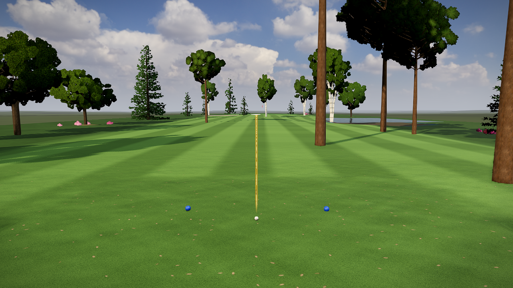
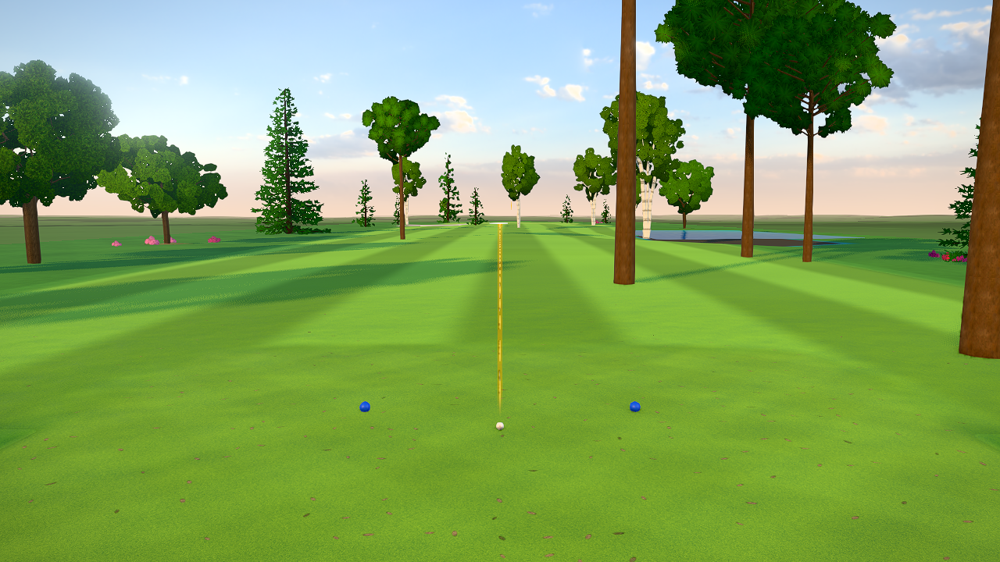
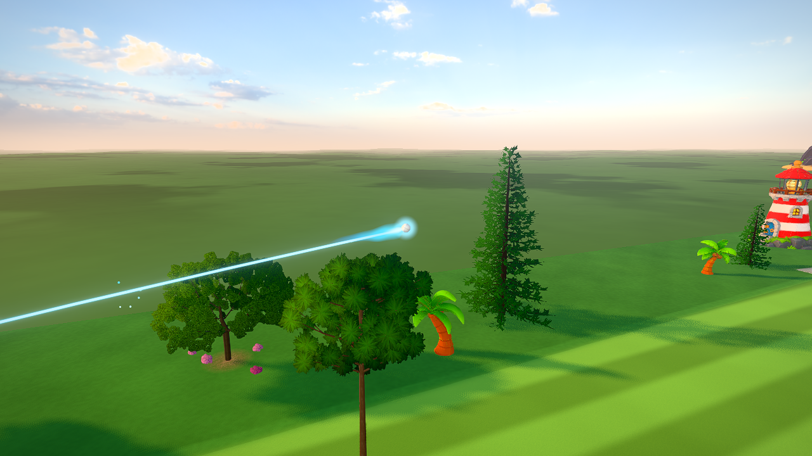

# The arcade look

A second, switchable look for the same procedural renderer, aimed at the concept art in
`docs/art/concepts/` (a bright mobile-arcade style): candy-lime striped fairways, cream-white sand,
turquoise water with a foam rim, a warm low sun with long soft shadows, a thin pastel haze,
brighter canopies, a big yellow flag, a fat glowing ball trail, and GLB set pieces
(lighthouse, palms, rock arch, volcano) placed from the course's own data.

The default look is untouched. `scene.look` (`'real'` | `'arcade'`) is the one flag every
hook reads, and every hook hands back its input unchanged in the real look.

| | |
|---|---|
| Real (default) |  |
| Arcade |  |
| Arcade + `course.props` |  |
| Arcade trail (`trailColor`) |  |
| Rocket ball (`trailHeat: 1`, the blue rocket), from beside it |  |
| The same rocket ball from the follow camera (the flame end-on) |  |

Frames are the committed synthetic fixture course
(`test/fixtures/visual-capture-data/courses/synthetic-visual.json`), 1280x720, High
graphics, captured through the app's own `?visualCapture=1` still path.

## Switching it

```js
new GolfScene(el, { look: 'arcade' });   // start in it ('real' is the default)
scene.setLook('arcade');                  // or switch at run time; returns a promise (the sky is in)
scene.setLook('real');
scene.look;                               // 'real' | 'arcade'
scene.onLookChange = (look) => {};        // optional: called after a switch
```

`setLook` changes the live settings at once (tone mapping, grade, bloom, shadow softness,
pin, landing effects), re-applies the sky (its light carries the look) and rebuilds the
course scenery (turf, water and trees are built per look). The rebuild is the one a
graphics-quality change already does, and like it is deferred while a shot is replaying.

The look brings its own sky (`ARCADE_LOOK.sky.preset`, the existing `golden` preset): the
scene switches to it on entering the look and goes back to the player's sky on leaving,
unless the player picked another one meanwhile. `scene.setLook('arcade', { keepSky: true })`
stays on the sky that is showing, and `ARCADE_LOOK.sky.preset = null` turns the switch off
altogether. The player can still pick any time of day in the arcade look; the look's sun
colour, height, fill and haze are laid over whichever preset is showing (overcast and fog
keep their own sun). No new HDR is fetched: `golden` is the Poly Haven sky the game server
already caches for the Time-of-day setting, and it falls back to the bundled midday sky
exactly as that setting does.

## What it changes

Everything is one object, `ARCADE_LOOK` in `public/render/arcade-look.js`. Edit a value,
reload the page.

| Group | What it drives | Where it lands |
|---|---|---|
| `palette` | Ground colours, key for key with `course-character.js` `COLORS` (base, rough, wood, range, fairwayA/B, greenA/B, tee, bunker, water). | `scene._pal`: the splat, the green override, the ground apron |
| `character` | `courseDry: 0`, `fescue: 0`: every arcade course is lush parkland (no tan links palette, no tall straw, white sand). | `scene._courseDry`, `scene._fescue` |
| `turf` | `stripeStatic` (0 = the real view-dependent sheen, 1 = painted bands), `stripeGain`, `crossGain` (the cross set: 1 makes a plaid), `stripeM` (band width), `saturation`, `gain`, `collar` (the apron ring round a green), `sand` / `sandMix` (sand painted on the ground), `sandGain` / `sandGlow` (the bunker meshes: brighter, and part of the colour unlit so they stay cream under a low sun), `macro` (the aerial photo's tint and far-photo weights, loosened so the candy colours hold). | `turf.js` behind `#ifdef TURF_ARCADE`; `scene._macro` |
| `water` | `deep`, `shallow`, `shallowReachM`, `shallowMix`, `foam`, `foamM`, `reflect` (share of the mirror kept), `glint`; `sea.*` the same for open water. | `water.js` behind `#ifdef WATER_ARCADE` |
| `light` | `sunColor`, `sunIntensityMul`, `sunAltitudeDeg`, `environmentMul`, `exposureMul`, `shadowRadiusMul`. | `_applySky`, `setQuality` |
| `fog` | `color` + `colorMix` (pull the haze toward a pastel), `densityMul`. | `_applySky` |
| `sky` | `preset` (an existing `sky-presets.js` key or null), `backgroundIntensity`. | `applyLook` |
| `grade` | `toneMapping` (`'neutral'` keeps saturated colours saturated; `'aces'` is the real look's; `'agx'`), `contrast`, `saturation`, `vignette`, `bloom { strength, radius, threshold }`. | `renderer.toneMapping`, `postfx.setLook` |
| `trees` | `leaves` (tint per species), `leafMix`, `leafGain`. | `trees.js` `TreeField({ look })` |
| `flag` | `colors { cloth, hem, ink }`, `scale` (the cloth), `poleScale`. | `pin-flag.js` `makePin(colors)`; the parts are resized in `arcade-look.js` |
| `trail` | The ball trail: `color`, `core`, `widthPx` (the comet at the ball), `freshS` (how long the comet tapers), `thin` / `tail` (the trail behind it), `gain`, `headGlowPx`. | `shot-fx.js` behind `#ifdef TRACER_ARCADE` |
| `rocket` | The rocket ball (`opts.trailHeat`, any look): `color` (when the shot gives no `trailColor`), `lengthPx` / `widthPx` at heat 0 .. 1, `sparksPerS`, `sparkPx`, `burst`, `sparks` / `lowSparks` / `lowRate` (the pool and rate, and Low graphics'), `glowPx`, `glowAlpha`. | `shot-fx.js` `RocketFx` |
| `impact` | `sizeMul`, `countMul` for the splash / sand / turf thrown up on landing. | `impact-fx.js` |
| `props` | The GLB models' materials: `roughness`, `metalness`, `envMapIntensity`, `glow` (their base colour given back as emissive). | `props.js` `_dress` |

Tuning notes from getting it to read like the concepts:

- Saturation stacks. The palette, `turf.saturation`, the neutral tone mapping and
  `grade.saturation` all push the same way; the first attempt (grade 1.3, turf 1.18) came out
  radioactive. Push the palette's hue first, the grade last.
- Painted stripes need far less gain than the sheen they replace: at `stripeStatic: 1` a
  `stripeGain` of 0.85 already gives a light/dark ratio near 1.5.
- A low sun barely lights level ground. Turf has `lowSunLift`; sand has nothing, which is
  why `sandGlow` exists. If you lower `sunAltitudeDeg` further, raise it.
- The turquoise shallows and the foam rim need the terrain depth pre-pass: High or Ultra
  graphics, with a pond within 300 m. Without it a pond is its `deep` colour edge to edge.

## The shot: trail, tint, rocket ball, real time

`scene.playShot(points, flightTime, onDone, opts)` takes four more options. All are off
by default, none changes a shot played without them, and none needs the arcade look.

| Option | Type | Effect |
|---|---|---|
| `opts.realTime` | `true` | Plays the points at their own timestamps. Without it a replay longer than 14 s is fast-forwarded to fit 14 s (`speed = dur / 14`), which would undo a slow-motion shot whose timestamps were stretched before the call (`public/arcade/feel.js`). |
| `opts.trail` | `true` / `false` | `true`: the arcade trail in any look. `false`: the plain tracer even in the arcade look. Left out: by look. |
| `opts.trailColor` | hex number or CSS colour | Tints the tracer, the glow round the ball and the rocket flame for this shot. In the real look without `trail: true` it tints the plain tracer and leaves its shape alone. |
| `opts.trailHeat` | number, `> 0` up to 1 | A rocket ball. While the ball is in the air (`t < flightTime`; never a putt) an exhaust flame burns on it and it sheds sparks. 0, negative, `NaN` or absent: nothing is built. Values over 1 count as 1. |

**The arcade trail** is a 16 px comet on the ball tapering over 0.45 s of flight into an
8 px line that keeps 70% of its strength (the real tracer fades to 30% so it never covers
the shot). Its halo stays the trail's own colour, under the bloom's threshold; only the
core is bright enough to bloom, and that core is fat in the comet and a fine line behind
it. (An earlier version bloomed the whole ribbon, which washed a tinted trail out to
near-white along its length.) A tinted trail's core is the tint white-hot rather than the
look's cream. The in-flight glow round the ball grows from 13 to 34 px and takes the
trail's colour, and is put back to the scene's own on the next plain shot.

**The rocket ball** (`shot-fx.js` `RocketFx`, built by `arcade-look.js` `shotRocket`):

- A tapered flame pointing back along the ball's flight: white-hot at the ball, through
  `trailColor` (orange `#ff8a1f` without one), to a deeper tone at the tip. A warm tint
  burns down toward red-orange, a cool one (the blue rocket) to a deeper blue
  (`flameColors`). It flickers: the tip dances, tongues run down it, it wavers.
- Sized in screen pixels like the tracer (the ball in flight is a few pixels across at
  any distance): 70 to 190 px long and 22 to 38 px wide off the club at heat 0 to 1,
  shrinking to about 55% by landing. The shrink follows how far down its carry the ball
  is, not the clock, because `feel.js` re-times the timestamps for slow motion.
- Seen from behind (the follow camera looks straight up the exhaust, where a strip is
  edge-on) the same flame is drawn as a ragged ball of fire round the ball; the two
  cross-fade with the viewing angle.
- Sparks: GPU point sprites from a pool of 120 (40 on Low graphics, at 40% of the rate),
  about 0.4 s each, thrown back and out with gravity and drag, white-hot cooling through
  the tint. Up to 140 a second at heat 1 off the club.
- The glow round the ball is a quarter bigger and a third brighter at heat 1.
- With the arcade trail, the flame is the comet: the ribbon behind it is the plain 8 px
  line from the ball back, so the flame is not hidden inside a 16 px comet.
- It stops at first ground (or water) contact with a small burst of sparks thrown up from
  the spot, and is removed and disposed once the last spark has burned out (about 0.7 s).
  The next shot, a new hole, or the tracer's linger ending clears it with the tracer.
- Cost when `trailHeat` is absent: one `if (this.rocket)` a frame. Nothing is allocated.
  A rocket shot adds three draw calls (flame strip, plume quad, spark points).

What `public/app.js` passes today: `{ trail: true, trailColor, trailHeat }` with GREAT
`0xff5a2a` / 0.6, PERFECT `0xff8a1f` / 0.85, JACKPOT `0xffd21f` / 1, and the power-up
balls (rocket `0x4fd8ff` / 1); ordinary shots pass none of them.

## Props: GLB set pieces from the course

`public/render/props.js` `PropsLayer`, on every scene as `scene.props`.

```jsonc
// in the course JSON (already passed through server.js courseGeometry as geo.props)
"props": [
  { "id": "lh1", "kind": "lighthouse", "x": -62, "y": 262, "rotDeg": 20 },
  { "id": "p1",  "kind": "palm", "x": -38, "y": 30 },
  { "id": "p2",  "kind": "palm", "x": 40, "y": 60, "rotDeg": 70, "heightM": 11 },
  { "id": "v",   "kind": "volcano", "x": -260, "y": 900 },
  { "id": "x",   "url": "/api/props/my-model.glb", "x": 10, "y": 120, "heightM": 6, "scale": [1, 1.2, 1] }
]
```

| Field | |
|---|---|
| `x`, `y` | Course frame, metres (x east, y north). Required. |
| `kind` | A model name (letters, digits, `-`, `_`): one of the procedural kinds (built in code, see Procedural props below), or a GLB fetched from `/arcade/props/<kind>.glb`. |
| `url` | Any other model: a path on this server (must start with `/`). Wins over `kind`. A URL on another host is ignored: a course file cannot make the game call out. |
| `heightM` | The model is scaled uniformly so it stands this tall. A default for every kind (`PROP_KIND_HEIGHT_M`: lighthouse 28, palm 9, rock-arch 18, volcano 140, and the procedural kinds). Without a height and without a known kind the model keeps its own units. A `target-ring`'s is its diameter, a `bridge`'s its length. |
| `scale` | Extra multiplier on top: a number, or `[x, y, z]` along the model's axes. |
| `rotDeg` | Turn about the vertical, clockwise seen from above; 0 = as modelled (glTF +X east, +Z south). |
| `sinkM` | How far the base is sunk into the ground (default 0.3) so the downhill side of a slope never shows daylight. Raise it on steep ground. |
| `z` | Put the base at this height (course z) instead of on the terrain; nothing is sunk then. |
| `castShadow` | `false` to keep a model out of the shadow map (per model: one copy casting makes all its copies cast). |
| `id` | For `scene.props.remove(id)`. |

How a model is placed: the bounding box is measured after load (the generated models are
centred on the origin, so the base is `bbox.min.y`, not 0); the bottom of the box is set
on `hAt(x, y)` less `sinkM`; course (x, y, z) maps to three (x, z, -y) through the scene's
own `V`, the same as trees and the pin. Each distinct model is fetched and parsed once
and every copy is an instance: one `InstancedMesh` per mesh in the file however many
times it stands (six palms were one draw call of 8,167 triangles in the capture above).
Models cast and receive shadows; base-colour textures are forced to sRGB. In the arcade
look their materials are made matte and non-metal with a little of their own colour as
glow (`ARCADE_LOOK.props`), and put back in the real look.

A model that is not there (404) is skipped silently and listed in `scene.props.skipped`;
one that fails to parse is skipped with one console warning. three's `GLTFLoader` is
imported only when a course first has props, and it uses its own loading manager, so
props never touch the course's load state (or the visual-capture readiness gate).

```js
await scene.props.add({ kind: 'palm', x: 12, y: 80 });   // or an array; resolves to { placed, skipped }
scene.props.remove('p1');
scene.props.clear();
await scene.props.ready;       // everything asked for so far is in (or skipped)
scene.props.skipped;           // [{ url, reason: 'missing' | 'http-500' | 'error' }]
```

A new course clears the last course's props and frees their geometry, materials and
textures. A scenery rebuild of the same course (quality or look change) keeps the loaded
models and re-seats the instances.

Limits: static meshes only (no skinning or animation), no Draco / meshopt / KTX2
decoders wired (the generated models use none), and the sun's shadow map is fitted to
the hole in play, so a prop far from it receives light but casts no shadow.

## Themes: every stage its own world

An arcade stage says which world it is in its course file, `course.arcade = { theme,
timeOfDay }` (docs/dev/arcade-v2-contract.md; `server.js` `courseGeometry()` passes it through
as `geo.arcade`). A theme is a layer of overrides on `ARCADE_LOOK`, a time of day another
layer on top, and `resolveLook(theme, timeOfDay)` merges them into one complete look of
`ARCADE_LOOK`'s shape. The scene keeps the look of the course that is loaded
(`scene._arcadeLook`, set in `lookCourse`), and every hook reads it when it is handed the
scene (`lookTurf(scene)`); handed a bare look name (`lookTurf('arcade')`) a hook answers
for the plain arcade look, as before.

What cannot have moved: a course with no theme, an unknown theme, and `tropical` by day
all resolve to **`ARCADE_LOOK` itself** (the same object), and in the real look every hook
still returns its input whatever theme the course carries.

| Theme | Stage | Ground | Water | Sky and light | `course.trees` |
|---|---|---|---|---|---|
| `tropical` | Lagoon Island, Bullseye Bay | the arcade look as it shipped | turquoise, foam rim | `golden` photo, low warm sun | bright broadleaf |
| `canyon` | Canyon Run | red rock off the fairway, cream sand | turquoise river | `morning` photo, warm sun, peach haze | dusty juniper (all drawn as pine, sage tint, 0.85 size) |
| `links` | Lighthouse Point | golden fescue rough, cooler fairway | deep cold blue, wide surf | `morning` photo, cool haze | darker, a touch smaller |
| `volcano` | Volcano Drop | basalt, black sand | **lava**: a dark crust broken by slow glowing veins, white-hot rim at the bank (`water.glow.mode: 'lava'`) | painted ash and ember sky at every time of day, an orange up-light from the lake | charred (all birch, ember tint, lit from below) |
| `alpine` | Frostbite Ridge, Ice Pick | **snow** off the fairway (lifted to white: `turf.glow.baseLift`), smooth (`turf.normalScale`), tan sand | pale ice, near-still (`chopMul: 0.12`), bright glint | `morning` photo, exposure down a little | conifers only (oak, maple -> fir), **snow on the crowns** |
| `sakura` | Sakura Garden | moss, white gravel | a green garden pond, a mirror | `morning` photo, pink haze | **blossom**: broadleaves repainted pink and white, conifers stay green |
| `jungle` | Temple Run | deep green, lime fairway | jade river | `morning` photo, thick green mist (fog x1.7) | broadleaf only, 1.18 size |
| `desert` | Pharaoh's Gate | sand to the horizon, near-white bunkers | turquoise oasis | `midday` photo, hard sun at 38 degrees | dry olive, 0.85 size |
| `neon` | Midnight Mile | dark teal, a self-lit fairway with **glowing magenta edges**, a cyan ring round the green, lavender sand | **black**, mirrors the city, streaks of magenta and cyan standing in it, a neon rim | always night (`always: 'night'`): painted purple sky, city glow on the horizon | lit warm from below |
| `stadium` | Thunder Dome | a pitch mown in a plaid (5 m bands both ways), white sand | as tropical | `midday` photo by day; floodlit at night | as tropical, brighter |

Each theme also sets its own cliff rock (below), flag (alpine red, sakura pink, neon
yellow), default trail colour and, where the ground is bright or burning, a dark rim on
the trail and a dark halo behind the ball.

### Time of day

`day` is the theme as above. `golden` puts it under the `golden` sky photo with a sun at
12 degrees. `dusk` and `night` have no photo: the sky is **painted**
(`public/render/arcade-sky.js`), an equirect radiance map built from a small spec (a
gradient, glows on the horizon, a sun or moon disc, stars, a cloud band) and handed to
the scene through the same door as a sky photo, so the image-based light, the visible
sky, the horizon dome and the water's reflections all come from it. `scene._applySky`
takes `lookSkyPaint(scene)` in place of the HDR when the look has one.

Night golf has to stay playable, so a night is floodlit, not dark:

- the key light is a cool "floodlight" from 56 degrees up or more (short shadows, level
  ground fully lit), with one `HemisphereLight` as fill (`light.fill`; the only extra
  light a theme ever adds, made on first use);
- the mown ground gives back part of its own colour unlit (`turf.glow.lift`), and the
  fairway's and the green's edges glow (`turf.glow.edge`, `greenEdge`: the half-way band
  of the soft surface masks, about 1.5 m wide), compiled in behind `TURF_GLOW`;
- the flag cloth is self-lit (`flag.glow`), the props' emissive parts are turned up
  (`props.emissive`) and everything gives back a little of its own colour (`props.self`);
- bloom is kept LOW (strength 0.17, threshold 1.3). The first pass used 0.42 / 0.95 and
  the whole neon city dissolved into a pink haze: at night there is a lot of emissive on
  screen, and it all blooms.

`neon` is only ever a night, whatever the stage file says; `volcano` keeps its own painted
sky at every time of day.

### New knobs on `ARCADE_LOOK` (all neutral in the plain look)

| Knob | |
|---|---|
| `turf.cliff { a, b, from, to, strataM }` | Steep ground drawn as rock (`TURF_CLIFF`), see below. `null` turns it off. |
| `turf.glow { lift, baseLift, edge, edgeGain, greenEdge, greenEdgeGain }` | Night golf and snow (`TURF_GLOW`). `null`: none of it is compiled. |
| `turf.normalScale` | The blade normal map's strength (snow is smoother). |
| `turf.sandTint` | Multiplies the bunker meshes' colour (black volcanic sand). |
| `water.glow { mode: 'lava' | 'neon', color, hot, crust, strength, scaleM, speed }` | Self-lit water (`WATER_GLOW` in the pond and sea shaders). |
| `water.chopMul` | Ripple height, x what the wind gives. |
| `light.fill { sky, ground, intensity }` | The one scene-level fill light. |
| `sky.paint` | A painted sky spec plus `light`, the whole sky preset that goes with it. |
| `trees.species`, `trees.scale` | Species swapped and sizes scaled by `lookTreeSpots` (count and positions never change: the ball still hits the real tree, so `scale` stays within 0.8 .. 1.25). |
| `trees.fx { paint, paintMix, snow, snowAmount, uplight, uplightGain }` | Leaves repainted by their own light and dark, snow on the crown's top and outside, a warm light from below (`trees.js`, compiled only for a theme that has `fx`). |
| `flag.glow` | The cloth's own colour given back unlit. |
| `trail.outline { color, strength }` | A dark rim along the trail (`TRACER_OUTLINE`). |
| `ball.halo { color, px, alpha }` | A dark glow behind the ball in flight (`lookBallHalo`). |
| `props.emissive`, `props.self` | x the procedural props' glowing parts; their own colour given back unlit. |

### Steep ground is rock

The turf is painted from above, so down a cliff its stripes and edges smeared into
vertical streaks. Past about 40 degrees (`cliff.to` .. `cliff.from`, the cosine of the
slope) the ground is now drawn as rock: two colours in strata `strataM` apart, placed by
world HEIGHT (not by the map, so they run level across a face), bent by noise. This is in
the plain arcade look too (it is a fix, not a theme), so the arcade turf's program key is
now `turf-grain-v46-arcade-cliff`; `turf.cliff: null` gives back the turf everywhere. The
real look compiles none of it.

### Seeing a theme

`?theme=<name>&tod=<day|golden|dusk|night>` forces a theme (and / or a time of day) on
whatever course is loaded in the arcade look: `http://localhost:8314/?sound=0&theme=neon`.
`setLookThemeOverride(theme, timeOfDay)` does the same from code.

## Procedural props

Every prop kind of the contract that is not one of the four older GLBs is built in code:
`public/render/prop-models.js`, 51 kinds. Low-poly on purpose: bold silhouettes and flat
saturated colour that read from 300 yards.

| | Kinds |
|---|---|
| First wave | `cactus` `mesa` `pine` `snowman` `cabin` `ice-spire` `lava-rock` `lava-fall` `sakura-tree` `torii` `pagoda` `stone-lantern` `bridge` `temple` `idol` `pyramid` `obelisk` `sphinx` `skyscraper` `neon-sign` `billboard` `grandstand` `floodlight` `target-ring` `balloon` `blimp` `windmill` `shipwreck` `crystal` `torch` `flag-banner` |
| Second wave | `waterfall` `castle` `dragon` `giant-tree` `ruins` `jumbotron` `fireworks` `cloud` `airship` `statue` `fountain` `tiki` `hut` `boat` `gate` `tower` `rock-spire` `launch-ramp` `crowd` `bird-flock` |
| GLB | `lighthouse` `palm` `rock-arch` `volcano`, and any kind listed in the manifest (below) |

How it stays cheap with 150 to 300 props on a stage:

- **One merged geometry a kind, one material for them all, one `InstancedMesh` a kind.**
  Thunder Dome's 247 props are 18 draws; per-vertex colour, flat shading, no textures.
- **No lights.** What would need one is a per-vertex glow (`aFx.x`): windows, lava cracks,
  neon, flames, lamps. `props.emissive` scales it by theme.
- **No shadows from small props** (`shadow: false` on torches, lanterns, crowds, anything
  that floats); big ones cast into the cached shadow map like any scenery.
- **Motion is one uniform.** `scene._frame` calls `scene.props.update(t)`, which sets
  `uPropTime`; everything else is the vertex shader reading per-vertex attributes. No
  JavaScript runs per prop per frame.
- **Far small props cost no pixels.** Each copy has a cull distance (`aInst.w`,
  `propCullM(heightM)`: 340 m for a torch, growing with height, never for anything 12 m
  or taller, a bridge, a ring, or anything that floats) and shrinks away to nothing over
  the last 15% of it.

| Attribute | |
|---|---|
| `color` | Per-vertex colour (linear). |
| `aFx` = (glow, mode, sway, bob) | glow mode 0 steady, 1 a slow pulse running up the model (lava), 2 neon flicker, 3 flame, 4 flow (bands down a waterfall, across a screen). `sway`: cloth and blossom in the wind. `bob`: the whole model rising and falling. |
| `aSpin` = (hub x, hub y, rad/s, tint mask) | A part turning about the model's z axis (windmill sails, an airship's screw). Tint mask 1: this vertex takes the copy's own colour. |
| `aAnim` = (kind, phase, speed, amount), `aPivot` | 1 orbit: circling the vertical axis through the pivot, wing tips beating (`bird-flock`, `cloud`, `airship`). 2 burst: out from the pivot and fading on a cycle (`fireworks`). 3 bounce: hopping, out of step by `phase` (`crowd`: a wave runs along it). |
| `aInst` (per instance) = (r, g, b, cull m) | The copy's colour (balloons, banners, crystals, sails, flags each take one from the kind's palette) and its cull distance. |

Kinds that do not stand on the ground like a model:

- `target-ring`: `heightM` is its DIAMETER. Each is its own mesh, a band draped over the
  ground as it is drawn (`scene.drawnGroundAt`), 5 cm up, drawn with polygon offset and no
  depth write, so it hugs the green without z-fighting and the ball and the pin show over
  it. The band is 6% of the diameter wide (at least 0.5 m), so the smallest ring never
  covers the hole. Rings round one point are coloured by size, innermost first: gold,
  red, white, blue, red, white.
- `bridge`: `heightM` is its LENGTH; it spans along `rotDeg` (0 = north) about its point,
  stretched along the span (and a little wider and higher with it: `bridgeScale`), its
  deck ends on the higher of the two banks, piers reaching down into the water.
- `balloon` 60 m, `blimp` 120 m, `fireworks` 60 m, `cloud` 150 m, `airship` 100 m,
  `bird-flock` 40 m: lifted that far above their ground point (`PROP_FLOAT_M`). The ones
  that circle or drift (`roam`) are never frustum-culled.
- `crowd`: about `heightM` tall and four times as wide: four rows of twenty spectators
  (a body and a head each, in a crowd's colours), hopping out of step.

Standing them: `rotDeg` 0 faces a model's FRONT south (glTF +Z, as `L.facing()` in
`tools/arcade-holes/lib.js` assumes). A prop whose point is in water (a rock in the lava,
a wreck or a boat in the bay) is seated on the water's surface, not the bed
(`scene.waterLevelAt`). Models with a footprint have a foundation below their base
(`foot`), so a grandstand on a sloping bank shows no gap under its downhill side.

### GLB models from the manifest

`public/arcade/props/manifest.json`, `{ "kinds": { "<kind>": { "file": "<kind>.glb",
"tris": n, "heightM": h } } }`, is fetched once. A kind listed there is drawn from its GLB
(Y up, front +Z, origin at the centre of its base: it is stood on y = 0, its skirt goes
underground), and if the file is missing or will not parse the kind falls back to its
procedural model. `target-ring` is never a GLB. A manifest can only name `.glb` files in
the props folder. A GLB's own emissive materials are turned up with the look's
`props.emissive` and `props.self`, so they glow at night with the rest.

### Decisions on the models (integration pass)

- **Motion against detail.** Eight kinds lost their procedural motion when a GLB took over.
  Looked at in the stages: the GLB **crowd** (a packed, coloured stand), **flag-banner**,
  **boat**, **balloon**, **airship**, **jumbotron** and **torch** read better than what they
  replaced and stay GLBs, standing still. The **windmill** went back: a windmill that does
  not turn is the one thing a player notices, so `windmill` is no longer in
  `manifest.json` and the procedural one (white tower, red cap, turning sails) is drawn.
  `windmill.glb` is still in the folder: put the entry back to use it.
- **Variants.** A manifest entry may list `variants: [files]` (the skyscraper has three).
  Each prop gets one by a stable hash of its id, or of its position without one
  (`propVariantIndex`), so a skyline is varied and the same course always looks the same.
  Midnight Mile's 65 towers come out 19 / 23 / 23.
- **Skirts.** A manifest GLB's origin is its base (y = 0) and its skirt hangs below
  (`skirtM`). `_build` stands y = 0 on the ground less `sinkM` (0.3 m): measured in the
  running scene, castle, tower, cabin and ruins all sit 0.30 m into the ground at their
  centre, none proud of it. Nothing needed changing.
- **A prop the camera is inside fades to a ghost.** Props are scenery: nothing stops
  a ball coming to rest inside one's footprint (a water drop beside Canyon Run's waterfall),
  and the address camera then stood inside the model. `PropsLayer.setSeeThrough(line, cam, ball)`
  (each frame, from `scene._frame`; v2:seeover, it replaces QA's `setViewer`, which scaled the
  copy to nothing) draws as a ghost any copy of a model at least 3 m in radius that the camera
  is inside, or that the ball at rest lies inside, and, in the arcade, anything standing on the
  line of sight to the ball or over the first 60 m of the shot (`docs/arcade-feel.md` 1c).

### The prop gallery

`node .scratch/look/gallery.cjs` writes a scratch course
(`.scratch/look/data/courses/osm-node-9900000000900.json`) with every kind in rows on
flat ground, a pond, a bunker, a butte and a cliff:
`POST /api/load-course {"cached":"osm-node-9900000000900.json"}`, then add `?theme=...`.

## A Skipper ball's skip

`impactSchedule` (impact-fx.js) takes the `skip` events the server now sends for a ball
skipping off water: each throws the water splash where it skips (a little smaller than a
ball going in), flagged `skip: true`, and the ball stays in sight and flies on.

## Ball skins: the ball is the ball you armed

`public/render/ball-skins.js`. The 3D golf ball takes the look of the armed power-up ball
the moment it is picked, and keeps it through the strike, the flight, the bounces, the
roll and into the cup. The next ball is plain white again (or whatever is armed next).

```js
scene.setBallSkin(id | null, { curse, pop })   // the ball at rest. id: a ball of the arcade catalogue; null: plain.
                                               // curse: a trick on the player who is up ('gust' swirls wind round the
                                               // ball; 'tiny-cup' and 'fog' show nothing on it). pop: false for no pop.
scene.playShot(points, t, done, { ballSkin })  // the ball that was hit: its look is kept to the end of that shot,
                                               // whatever is set meanwhile
```

Changing the ball at rest pops it: a scale punch and a ring burst in the skin's colour.
A trick is never a skin (`ballSkinId('gust') === null`), and neither is an unknown id.

| Ball | At a glance (colour = `lib/arcade.js` `POWERUPS[].color`) | Up close | Idle |
|---|---|---|---|
| `rocket` | orange glow | steel, red nose and fins, a glowing nozzle band | a flame licking off the back |
| `fireball` | red-orange, flickering | charcoal with molten cracks | embers rising; scorches where it first lands |
| `ghost` | pale cyan, see-through, breathing | a little face | wisps; floats just off the grass |
| `gold` | gold | polished metal, a ring of stars | glints twinkling round it |
| `titan` | steel grey | black steel plates and rivets | dust at its foot; a heavier pop |
| `feather` | soft cream glow | quills and barbs | feather motes circling |
| `skipper` | blue | wet, a white ripple band (turning) | droplets hopping |
| `yoyo` | violet | two-tone halves, yellow stripes | the stripes spin |
| `homing` | green, blinking | a target reticle, a red light | the light blinks |
| `sticky` | honey amber | honey running down from the top | drips |
| `magnet` | red | red N pole, blue S pole, a steel band | sparks arcing between the poles |
| `windcutter` | pale cyan-silver | silver with swept cyan grooves (turning) | wind streaks across it |
| `laser` | hot magenta, the brightest | black with a neon grid | tight sparks |
| `moonball` | pale lilac | grey, cratered | floats and bobs in low gravity |
| `bouncy` | orange | a basketball | hops in place; squashes on every bounce, stretches in flight |

(`sticky` is honey, not green goo: its colour in the catalogue is amber, and the ball, its
trail and its dock token have to agree.)

How it is cheap: the ONE ball mesh with its material's maps and numbers swapped (a 512 x
256 canvas pattern a skin, painted the first time it is worn, plus a glow map for the
self-lit ones), one glow sprite (the aura, at rest and while rolling; in the air the
trail's own glow marks the ball), and one pool of 72 point sprites for everything that
comes off a ball (idle motes, the wisp or glitter left in the air, the burst at each
bounce). No lights. Nothing is built, and the ball's material is not touched, until a skin
is first put on; plain again is exactly the material the scene made. Sizes are in pixels
and grow with the ball's size on screen, so a skin reads from the tee (colour, aura,
motion) and close on the green (pattern).

The shot is in the ball's identity: `shotTrail` and `shotRocket` take `opts.ballSkin`'s
colour for the trail, the glow round the ball and the rocket flame (over any other
`trailColor`); the skin's motes are left along the flight; a bounce throws a burst in its
colours; the cup's burst (`cup-fx.js`) takes its colour when the ball drops.

`public/app.js` (edits marked `// v2:look`): `restBallLook({ match, arcade, strokes,
practice, holed, courseArcade })` says which ball lies at rest. In a match while someone is
up it is THEIR ball: the stage's `freeBall` on their first stroke of a rocket hole, else
their `armedPowerup`, with a gust on them shown. In solo play it is the arcade snapshot's
`armed`, or `course.arcade.freeBall` on the hole's first stroke. The ball in flight is
`shotBallSkin(shot)`: `shot.arcade.powerup`, or `shot.freeBall`.

### The ball cam's streak

In the ball cam (`scene.shotCam === 'ball'`) the camera sits 5.5 m behind the ball and the
trail streams back at the lens, so the arcade trail there is a bold streak
(`ARCADE_LOOK.trail.ballCam`): 44 px at the ball, narrowing toward the camera
(`TRACER_TAPER`: by distance from the lens, because only a tenth of a second of flight
lies between the ball and the camera) and fading out before it reaches it, coloured body
with only its spine hot, so it never whites out the view. The other cameras see the trail
from the side and keep the 16 px comet.

## Integration

### `public/app.js` (not edited here)

```js
import { parseLook } from './render/arcade-look.js';

// beside SKY_KEY: ?look=arcade overrides the saved choice; visual capture pins the real look
const LOOK_KEY = 'open-birdie.look';
const readLook = () => { try { return localStorage.getItem(LOOK_KEY); } catch { return null; } };
let lookSetting = parseLook(query.get('look') || (visualCaptureEnabled ? 'real' : readLook()));

const scene = new GolfScene($('scene'), { quality: gfxSetting, autoQuality: !visualCaptureEnabled, sky: skySetting, shotCam, look: lookSetting });
skySetting = scene.skySetting;   // the arcade look starts in its own sky: show that in the menu

// a menu toggle, next to Time of day
segmented($('seg-look'), [['real', 'Realistic'], ['arcade', 'Arcade']], lookSetting, (v) => {
  lookSetting = parseLook(v);
  try { localStorage.setItem(LOOK_KEY, lookSetting); } catch { /* private mode */ }
  markSeg($('seg-look'), lookSetting);
  scene.setLook(lookSetting).then(() => { skySetting = scene.skySetting; markSeg($('seg-sky'), skySetting); });
});
```

`public/index.html`, beside the Time-of-day row:

```html
<div class="set-row">
  <div class="set-text"><b>Look</b></div>
  <div class="seg" id="seg-look" role="radiogroup" aria-label="Look"></div>
</div>
```

Do not write the look's sky to `SKY_KEY`: the scene remembers the player's sky and goes
back to it. For the shot: pass `realTime: true` when `feel.js` has stretched the
timestamps past 14 s (it keeps them under that today, so this is a guard), the grade's
or power-up's colour as `trailColor`, and its heat as `trailHeat`:

```js
scene.playShot(shot.sim.points, shot.sim.flightTime, onDone, { ...opts, realTime: arcadeOn, trail: true, trailColor: 0x4fd8ff, trailHeat: 1 });
```

### `server.js`

One line, marked `// v2:look`: `courseGeometry()` passes `course.arcade` through as
`geo.arcade` (the theme and time of day). Nothing else is needed for the shipped models:
they are static files under `public/arcade/props/`, and `courseGeometry()` already passes
`course.props` through.
To serve a player's own models from the data directory at `/api/props/<file>` (use
`"url": "/api/props/<file>.glb"` in the entry, or construct the layer with
`baseUrl: '/api/props/'`), add beside the `/sky/` route:

```js
// GLB set pieces dropped in <data dir>/props (drawn by public/render/props.js)
if (p.startsWith('/api/props/')) {
  const name = path.basename(decodeURIComponent(p.slice('/api/props/'.length)));
  const full = path.join(DATA_DIR, 'props', name);
  if (!/^[a-z0-9][a-z0-9._-]*\.glb$/i.test(name) || !fs.existsSync(full)) { res.writeHead(404); return res.end('not found'); }
  res.writeHead(200, { 'Content-Type': 'model/gltf-binary' });
  return fs.createReadStream(full).pipe(res);
}
```

and, optionally, `'.glb': 'model/gltf-binary'` in `MIME` (the loader reads the bytes
whatever the type). `course.props` is scenery: keep it out of `canonicalCourse` / the HD
fingerprint, like `buildings` and `aerial`.

## The hooks in existing render files

All are no-ops in the real look. Shader additions sit inside `#ifdef`s whose define is
only set for the arcade variant, and the arcade variants have their own program cache
keys, so the real look compiles the programs it always did.

| File | Hook |
|---|---|
| `scene.js` | constructor option `look`, `this.look`, `setLook()`; `lookSkySetting` (start sky), `makePin(lookFlagColors(...))`, `this.props = new PropsLayer(...)`; `setQuality`: `lookShadowRadius`; `_applySky`: `lookSkyPreset`, the look's sun altitude, `lookFogColor`; `loadCourse`: `lookCourse(this)` before the scenery is built, `lookSand(...)` round the bunker material, `this.props.setCourse(geo)`; `_warmShaders`: `lookTracer`; `_turfInputs.arcade`; `buildWater(..., lookWater(...))`; `TreeField({ look })`; `playShot`: `opts.realTime`, `shotTrail(this, opts)`, `shotRocket(this, opts, carry)`; `_clearTrail`: the rocket goes with the tracer; `_updateShotFx`: `if (this.rocket) this._updateRocket(...)`, `lookBallHalo`. Themes: every hook is handed the scene (`lookTurf(this)`) so it sees the course's theme; `_applySky`: `lookSkyPaint` -> `paintedSkyEnvironment` in place of the sky photo; `_addTrees`: `lookTreeSpots`; `PropsLayer({ groundAt, waterAt })`; `_frame`: `this.props.update(t)`; `_animStep`: a `skip` splash does not hide the ball |
| `turf.js` | `makeTurfMaterial({ arcade })`: `uStripeM` from it, four `uArc*` uniforms, `#define TURF_ARCADE`, four `#ifdef TURF_ARCADE` blocks (collar, stripes, grass tone, sand), cache key suffix `-arcade`; `arcade.cliff`: `TURF_CLIFF` (rock on steep ground), suffix `-cliff`; `arcade.glow`: `TURF_GLOW` (night lift and glowing edges, snow lift), suffix `-glow`; `arcade.normalScale` |
| `water.js` | `buildWater(..., look)` / `buildSea(..., look)`: colours, `uArcWater` / `uArcSea` / `uArcFoam`, `WATER_ARCADE` define on the pond and sea materials, `#ifdef WATER_ARCADE` blocks (reflection share, shallows, foam), glint multiplier; `look.glow`: `WATER_GLOW` (`GLOW_GLSL`: lava, neon) on both; `look.chopMul` |
| `trees.js` | `TreeField` option `look`: leaf tint, mix and gain; `look.fx`: three uniforms and three shader lines (repaint, snow, up-light) compiled only when given (cache key suffix `-theme`) |
| `shot-fx.js` | `ShotTracer` option `arcade`: comet / trail uniforms, `TRACER_ARCADE` define (hot core, coloured halo, gain); `arcade.outline`: `TRACER_OUTLINE` (a dark rim); `RocketFx`, `flameColors`, `rocketFlame`, `rocketSpeedK` added at the end of the file (new code, only reached with `opts.trailHeat`) |
| `impact-fx.js` | `sizeMul`, `countMul` (both 1); `impactSchedule` takes `skip` events (a splash, flagged `skip`) |
| `postfx.js` | `setLook()` (grade uniforms + bloom), `this.output`, `BLOOM_DEFAULT` |
| `props.js` | `PropsLayer` added below the existing `buildRakes`: GLB and procedural kinds, the manifest, rings, bridges, floaters, `update(t)` |
| `arcade-sky.js` (new) | `paintSky` (pure), `paintedSkyEnvironment` |
| `prop-models.js` (new) | the 51 procedural models, `makePropMaterial`, `targetRingGeometry` |

## Proof the default is unchanged

- `npm run visual:smoke` (the real app in Electron, synthetic course, fixed time) is
  deterministic on this machine: two runs before any edit gave the same file,
  SHA-256 `20951617c5794eba011ac44c4618ab62e30ea4eb09f3bc88fa2820e877910238`. The same
  command after all the hooks gives the same hash, byte for byte.
- Round trip: real -> arcade -> props added and cleared -> real gives frames identical,
  pixel for pixel, to a plain `scene._rebuildScenery()` in the real look (the rebuild a
  quality change does). That rebuild is itself not pixel-identical to the first load
  (about 2 to 5% of pixels differ slightly, with no look code involved: it predates this
  work), so a toggled-back frame matches a rebuilt frame, not a freshly loaded one.
- `test/arcade-look.test.mjs`: in the real look every hook returns the very object or
  number it was given, the turf and tracer get no arcade define or uniform, no arcade
  GLSL sits outside an `#ifdef`, and a shot without `trailHeat` builds no rocket.

## Going further toward the concept art

What this look cannot reach by retuning the existing renderer, roughly in order of payoff:

1. **Stylised geometry.** The concepts are chunky modelled forms; this is still lidar
   terrain with photographed leaf cards. Low-poly canopy blobs (a `tree-gen.js` species
   set of 3 to 5 lumpy spheres with vertex colours), and rock / cliff meshes skirting
   greens and tees (rings of instanced boulders along surface outlines; `props.js`
   already instances them) would change the read more than any colour.
2. **A toon outline and banded shading pass.** A depth + normal edge pass after the
   `RenderPass` (the composer already carries a depth texture) for a soft dark outline,
   and two or three band diffuse on trees and props in place of smooth PBR.
3. **A real foam and caustics shader.** Foam here is a depth band from the terrain
   pre-pass: it needs High graphics, a pond within 300 m, and varies with the bed's
   slope. A signed-distance-to-shore texture per pond (as `sea.js` builds for the sea)
   would give an even animated rim, lapping lines and the caustic net of the lagoon
   concept at any quality level.
4. **Cloud sprites and a painted sky.** The sky is still an HDR photo. A gradient dome
   (pastel zenith to peach horizon) with a dozen billboarded puffy clouds, and a sun disc
   with a bloom flare, would match the concepts and remove the last photographic element.
5. **Soft bunker lips.** Bunkers are flat polygons with shaded edges. A small extruded
   lip (a bevelled ring mesh along the outline) with the sand dished 20 to 30 cm would
   give the moulded look.
6. **Themed ground.** Canyon sand, lava rock and snow need a per-course palette and
   non-grass base materials: a `course.theme` picking an `ARCADE_LOOK` variant
   (palette, fog colour, sky preset, prop set) is the natural next field.
7. **Flowers, tee furniture, the cup.** Hibiscus / lupin clumps (the flower instancer
   exists), chunky tee markers and a sparkle on the pin are cheap props-layer additions.
