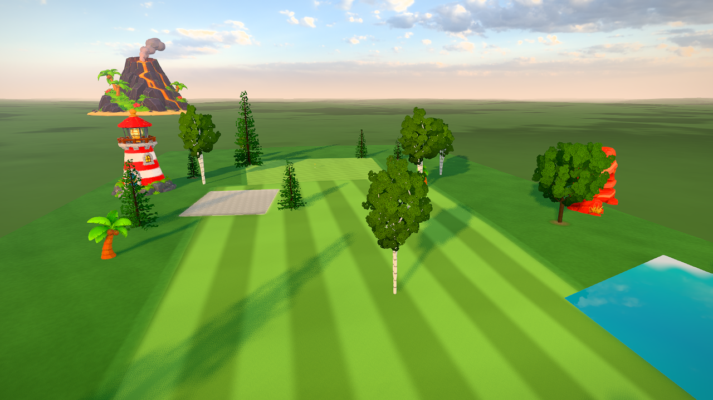
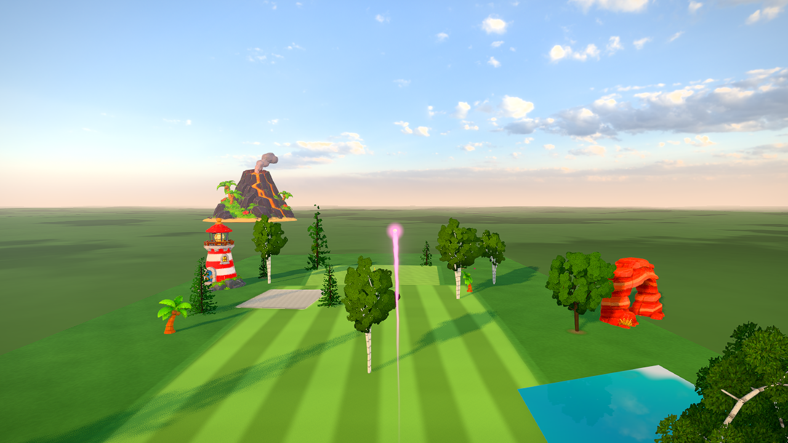
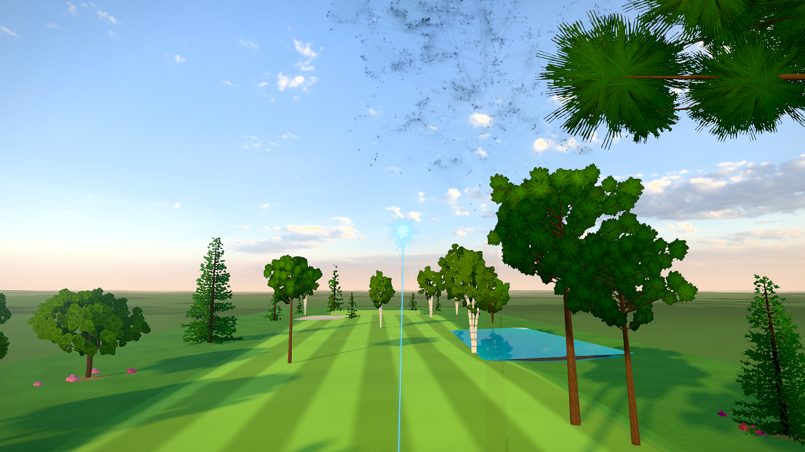

# The arcade look

A second, switchable look for the same procedural renderer, aimed at the concept art in
`docs/art/concepts/` (a bright mobile-arcade style): candy-lime striped fairways, cream-white sand,
turquoise water with a foam rim, a warm low sun with long soft shadows, a thin pastel haze,
brighter canopies, a big yellow flag, a fat glowing ball trail, and GLB set pieces
(lighthouse, palms, rock arch, volcano) placed from the course's own data.

The default look is untouched. `scene.look` (`'real'` | `'arcade'`) is the one flag every
hook reads, and every hook hands back its input unchanged in the real look.

| | |
|---|---|
| Real (default) |  |
| Arcade |  |
| Arcade + `course.props` |  |
| Arcade trail (`trailColor`) |  |
| Rocket ball (`trailHeat: 1`, the blue rocket), from beside it |  |
| The same rocket ball from the follow camera (the flame end-on) |  |

Frames are the committed synthetic fixture course
(`test/fixtures/visual-capture-data/courses/synthetic-visual.json`), 1280x720, High
graphics, captured through the app's own `?visualCapture=1` still path.

## Switching it

```js
new GolfScene(el, { look: 'arcade' });   // start in it ('real' is the default)
scene.setLook('arcade');                  // or switch at run time; returns a promise (the sky is in)
scene.setLook('real');
scene.look;                               // 'real' | 'arcade'
scene.onLookChange = (look) => {};        // optional: called after a switch
```

`setLook` changes the live settings at once (tone mapping, grade, bloom, shadow softness,
pin, landing effects), re-applies the sky (its light carries the look) and rebuilds the
course scenery (turf, water and trees are built per look). The rebuild is the one a
graphics-quality change already does, and like it is deferred while a shot is replaying.

The look brings its own sky (`ARCADE_LOOK.sky.preset`, the existing `golden` preset): the
scene switches to it on entering the look and goes back to the player's sky on leaving,
unless the player picked another one meanwhile. `scene.setLook('arcade', { keepSky: true })`
stays on the sky that is showing, and `ARCADE_LOOK.sky.preset = null` turns the switch off
altogether. The player can still pick any time of day in the arcade look; the look's sun
colour, height, fill and haze are laid over whichever preset is showing (overcast and fog
keep their own sun). No new HDR is fetched: `golden` is the Poly Haven sky the game server
already caches for the Time-of-day setting, and it falls back to the bundled midday sky
exactly as that setting does.

## What it changes

Everything is one object, `ARCADE_LOOK` in `public/render/arcade-look.js`. Edit a value,
reload the page.

| Group | What it drives | Where it lands |
|---|---|---|
| `palette` | Ground colours, key for key with `course-character.js` `COLORS` (base, rough, wood, range, fairwayA/B, greenA/B, tee, bunker, water). | `scene._pal`: the splat, the green override, the ground apron |
| `character` | `courseDry: 0`, `fescue: 0`: every arcade course is lush parkland (no tan links palette, no tall straw, white sand). | `scene._courseDry`, `scene._fescue` |
| `turf` | `stripeStatic` (0 = the real view-dependent sheen, 1 = painted bands), `stripeGain`, `crossGain` (the cross set: 1 makes a plaid), `stripeM` (band width), `saturation`, `gain`, `collar` (the apron ring round a green), `sand` / `sandMix` (sand painted on the ground), `sandGain` / `sandGlow` (the bunker meshes: brighter, and part of the colour unlit so they stay cream under a low sun), `macro` (the aerial photo's tint and far-photo weights, loosened so the candy colours hold). | `turf.js` behind `#ifdef TURF_ARCADE`; `scene._macro` |
| `water` | `deep`, `shallow`, `shallowReachM`, `shallowMix`, `foam`, `foamM`, `reflect` (share of the mirror kept), `glint`; `sea.*` the same for open water. | `water.js` behind `#ifdef WATER_ARCADE` |
| `light` | `sunColor`, `sunIntensityMul`, `sunAltitudeDeg`, `environmentMul`, `exposureMul`, `shadowRadiusMul`. | `_applySky`, `setQuality` |
| `fog` | `color` + `colorMix` (pull the haze toward a pastel), `densityMul`. | `_applySky` |
| `sky` | `preset` (an existing `sky-presets.js` key or null), `backgroundIntensity`. | `applyLook` |
| `grade` | `toneMapping` (`'neutral'` keeps saturated colours saturated; `'aces'` is the real look's; `'agx'`), `contrast`, `saturation`, `vignette`, `bloom { strength, radius, threshold }`. | `renderer.toneMapping`, `postfx.setLook` |
| `trees` | `leaves` (tint per species), `leafMix`, `leafGain`: the classic `TreeField` only (`?trees=classic`). The arcade worlds draw modelled species: see **Trees** below. | `trees.js` `makeTreeField` |
| `flag` | `colors { cloth, hem, ink }`, `scale` (the cloth), `poleScale`. | `pin-flag.js` `makePin(colors)`; the parts are resized in `arcade-look.js` |
| `trail` | The ball trail: `color`, `core`, `widthPx` (the comet at the ball), `freshS` (how long the comet tapers), `thin` / `tail` (the trail behind it), `gain`, `headGlowPx`. | `shot-fx.js` behind `#ifdef TRACER_ARCADE` |
| `rocket` | The rocket ball (`opts.trailHeat`, any look): `color` (when the shot gives no `trailColor`), `lengthPx` / `widthPx` at heat 0 .. 1, `sparksPerS`, `sparkPx`, `burst`, `sparks` / `lowSparks` / `lowRate` (the pool and rate, and Low graphics'), `glowPx`, `glowAlpha`. | `shot-fx.js` `RocketFx` |
| `impact` | `sizeMul`, `countMul` for the splash / sand / turf thrown up on landing. | `impact-fx.js` |
| `props` | The GLB models' materials: `roughness`, `metalness`, `envMapIntensity`, `glow` (their base colour given back as emissive). | `props.js` `_dress` |

Tuning notes from getting it to read like the concepts:

- Saturation stacks. The palette, `turf.saturation`, the neutral tone mapping and
  `grade.saturation` all push the same way; the first attempt (grade 1.3, turf 1.18) came out
  radioactive. Push the palette's hue first, the grade last.
- Painted stripes need far less gain than the sheen they replace: at `stripeStatic: 1` a
  `stripeGain` of 0.85 already gives a light/dark ratio near 1.5.
- A low sun barely lights level ground. Turf has `lowSunLift`; sand has nothing, which is
  why `sandGlow` exists. If you lower `sunAltitudeDeg` further, raise it.
- The turquoise shallows and the foam rim need the terrain depth pre-pass: High or Ultra
  graphics, with a pond within 300 m. Without it a pond is its `deep` colour edge to edge.

## The shot: trail, tint, rocket ball, real time

`scene.playShot(points, flightTime, onDone, opts)` takes four more options. All are off
by default, none changes a shot played without them, and none needs the arcade look.

| Option | Type | Effect |
|---|---|---|
| `opts.realTime` | `true` | Plays the points at their own timestamps. Without it a replay longer than 14 s is fast-forwarded to fit 14 s (`speed = dur / 14`), which would undo a slow-motion shot whose timestamps were stretched before the call (`public/arcade/feel.js`). |
| `opts.trail` | `true` / `false` | `true`: the arcade trail in any look. `false`: the plain tracer even in the arcade look. Left out: by look. |
| `opts.trailColor` | hex number or CSS colour | Tints the tracer, the glow round the ball and the rocket flame for this shot. In the real look without `trail: true` it tints the plain tracer and leaves its shape alone. |
| `opts.trailHeat` | number, `> 0` up to 1 | A rocket ball. While the ball is in the air (`t < flightTime`; never a putt) an exhaust flame burns on it and it sheds sparks. 0, negative, `NaN` or absent: nothing is built. Values over 1 count as 1. |

**The arcade trail** is a 16 px comet on the ball tapering over 0.45 s of flight into an
8 px line that keeps 70% of its strength (the real tracer fades to 30% so it never covers
the shot). Its halo stays the trail's own colour, under the bloom's threshold; only the
core is bright enough to bloom, and that core is fat in the comet and a fine line behind
it. (An earlier version bloomed the whole ribbon, which washed a tinted trail out to
near-white along its length.) A tinted trail's core is the tint white-hot rather than the
look's cream. The in-flight glow round the ball grows from 13 to 34 px and takes the
trail's colour, and is put back to the scene's own on the next plain shot.

**The rocket ball** (`shot-fx.js` `RocketFx`, built by `arcade-look.js` `shotRocket`):

- A tapered flame pointing back along the ball's flight: white-hot at the ball, through
  `trailColor` (orange `#ff8a1f` without one), to a deeper tone at the tip. A warm tint
  burns down toward red-orange, a cool one (the blue rocket) to a deeper blue
  (`flameColors`). It flickers: the tip dances, tongues run down it, it wavers.
- Sized in screen pixels like the tracer (the ball in flight is a few pixels across at
  any distance): 70 to 190 px long and 22 to 38 px wide off the club at heat 0 to 1,
  shrinking to about 55% by landing. The shrink follows how far down its carry the ball
  is, not the clock, because `feel.js` re-times the timestamps for slow motion.
- Seen from behind (the follow camera looks straight up the exhaust, where a strip is
  edge-on) the same flame is drawn as a ragged ball of fire round the ball; the two
  cross-fade with the viewing angle.
- Sparks: GPU point sprites from a pool of 120 (40 on Low graphics, at 40% of the rate),
  about 0.4 s each, thrown back and out with gravity and drag, white-hot cooling through
  the tint. Up to 140 a second at heat 1 off the club.
- The glow round the ball is a quarter bigger and a third brighter at heat 1.
- With the arcade trail, the flame is the comet: the ribbon behind it is the plain 8 px
  line from the ball back, so the flame is not hidden inside a 16 px comet.
- It stops at first ground (or water) contact with a small burst of sparks thrown up from
  the spot, and is removed and disposed once the last spark has burned out (about 0.7 s).
  The next shot, a new hole, or the tracer's linger ending clears it with the tracer.
- Cost when `trailHeat` is absent: one `if (this.rocket)` a frame. Nothing is allocated.
  A rocket shot adds three draw calls (flame strip, plume quad, spark points).

What `public/app.js` passes today: `{ trail: true, trailColor, trailHeat }` with GREAT
`0xff5a2a` / 0.6, PERFECT `0xff8a1f` / 0.85, JACKPOT `0xffd21f` / 1, and the power-up
balls (rocket `0x4fd8ff` / 1); ordinary shots pass none of them.

## Props: GLB set pieces from the course

`public/render/props.js` `PropsLayer`, on every scene as `scene.props`.

```jsonc
// in the course JSON (already passed through server.js courseGeometry as geo.props)
"props": [
  { "id": "lh1", "kind": "lighthouse", "x": -62, "y": 262, "rotDeg": 20 },
  { "id": "p1",  "kind": "palm", "x": -38, "y": 30 },
  { "id": "p2",  "kind": "palm", "x": 40, "y": 60, "rotDeg": 70, "heightM": 11 },
  { "id": "v",   "kind": "volcano", "x": -260, "y": 900 },
  { "id": "x",   "url": "/api/props/my-model.glb", "x": 10, "y": 120, "heightM": 6, "scale": [1, 1.2, 1] }
]
```

| Field | |
|---|---|
| `x`, `y` | Course frame, metres (x east, y north). Required. |
| `kind` | A model name (letters, digits, `-`, `_`): one of the procedural kinds (built in code, see Procedural props below), or a GLB fetched from `/arcade/props/<kind>.glb`. |
| `url` | Any other model: a path on this server (must start with `/`). Wins over `kind`. A URL on another host is ignored: a course file cannot make the game call out. |
| `heightM` | The model is scaled uniformly so it stands this tall. A default for every kind (`PROP_KIND_HEIGHT_M`: lighthouse 28, palm 9, rock-arch 18, volcano 140, and the procedural kinds). Without a height and without a known kind the model keeps its own units. A `target-ring`'s is its diameter, a `bridge`'s its length. |
| `scale` | Extra multiplier on top: a number, or `[x, y, z]` along the model's axes. |
| `rotDeg` | Turn about the vertical, clockwise seen from above; 0 = as modelled (glTF +X east, +Z south). |
| `sinkM` | How far the base is sunk into the ground (default 0.3) so the downhill side of a slope never shows daylight. Raise it on steep ground. |
| `z` | Put the base at this height (course z) instead of on the terrain; nothing is sunk then. |
| `castShadow` | `false` to keep a model out of the shadow map (per model: one copy casting makes all its copies cast). |
| `id` | For `scene.props.remove(id)`. |

How a model is placed: the bounding box is measured after load (the generated models are
centred on the origin, so the base is `bbox.min.y`, not 0); the bottom of the box is set
on `hAt(x, y)` less `sinkM`; course (x, y, z) maps to three (x, z, -y) through the scene's
own `V`, the same as trees and the pin. Each distinct model is fetched and parsed once
and every copy is an instance: one `InstancedMesh` per mesh in the file however many
times it stands (six palms were one draw call of 8,167 triangles in the capture above).
Models cast and receive shadows; base-colour textures are forced to sRGB. In the arcade
look their materials are made matte and non-metal with a little of their own colour as
glow (`ARCADE_LOOK.props`), and put back in the real look.

A model that is not there (404) is skipped silently and listed in `scene.props.skipped`;
one that fails to parse is skipped with one console warning. three's `GLTFLoader` is
imported only when a course first has props, and it uses its own loading manager, so
props never touch the course's load state (or the visual-capture readiness gate).

```js
await scene.props.add({ kind: 'palm', x: 12, y: 80 });   // or an array; resolves to { placed, skipped }
scene.props.remove('p1');
scene.props.clear();
await scene.props.ready;       // everything asked for so far is in (or skipped)
scene.props.skipped;           // [{ url, reason: 'missing' | 'http-500' | 'error' }]
```

A new course clears the last course's props and frees their geometry, materials and
textures. A scenery rebuild of the same course (quality or look change) keeps the loaded
models and re-seats the instances.

Limits: static meshes only (no skinning or animation), no Draco / meshopt / KTX2
decoders wired (the generated models use none), and the sun's shadow map is fitted to
the hole in play, so a prop far from it receives light but casts no shadow.

## Themes: every stage its own world

An arcade stage says which world it is in its course file, `course.arcade = { theme,
timeOfDay }` (docs/dev/arcade-v2-contract.md; `server.js` `courseGeometry()` passes it through
as `geo.arcade`). A theme is a layer of overrides on `ARCADE_LOOK`, a time of day another
layer on top, and `resolveLook(theme, timeOfDay)` merges them into one complete look of
`ARCADE_LOOK`'s shape. The scene keeps the look of the course that is loaded
(`scene._arcadeLook`, set in `lookCourse`), and every hook reads it when it is handed the
scene (`lookTurf(scene)`); handed a bare look name (`lookTurf('arcade')`) a hook answers
for the plain arcade look, as before.

What cannot have moved: a course with no theme, an unknown theme, and `tropical` by day
all resolve to **`ARCADE_LOOK` itself** (the same object), and in the real look every hook
still returns its input whatever theme the course carries.

| Theme | Stage | Ground | Water | Sky and light | `course.trees` |
|---|---|---|---|---|---|
| `tropical` | Lagoon Island, Bullseye Bay | the arcade look as it shipped | turquoise, foam rim | `golden` photo, low warm sun | bright broadleaf |
| `canyon` | Canyon Run, Sky Fortress | tan dust off the fairway, red rock walls with cream bands, cream sand | teal river | `morning` photo, a warm white sun, pale dusty haze | dusty juniper (all drawn as pine, sage tint, 0.85 size) |
| `links` | Lighthouse Point | golden fescue rough, cooler fairway | deep cold blue, wide surf | `morning` photo, cool haze | darker, a touch smaller |
| `volcano` | Volcano Drop | basalt, black sand | **lava**: a dark crust broken by slow glowing veins, white-hot rim at the bank (`water.glow.mode: 'lava'`) | painted ash and ember sky at every time of day, an orange up-light from the lake | charred (all birch, ember tint, lit from below) |
| `alpine` | Frostbite Ridge, Ice Pick | **snow** off the fairway (lifted to white: `turf.glow.baseLift`), smooth (`turf.normalScale`), tan sand | pale ice, near-still (`chopMul: 0.12`), bright glint | `morning` photo, exposure down a little | conifers only (oak, maple -> fir), **snow on the crowns** |
| `sakura` | Sakura Garden | moss, white gravel | a green garden pond, a mirror | `morning` photo, pink haze | **blossom**: broadleaves repainted pink and white, conifers stay green |
| `jungle` | Temple Run | deep green, lime fairway | jade river | `morning` photo, thick green mist (fog x1.7) | broadleaf only, 1.18 size |
| `desert` | Pharaoh's Gate | sand to the horizon, near-white bunkers | turquoise oasis | `midday` photo, hard sun at 38 degrees | dry olive, 0.85 size |
| `neon` | Midnight Mile | dark teal, a self-lit fairway with **glowing magenta edges**, a cyan ring round the green, lavender sand | **black**, mirrors the city, streaks of magenta and cyan standing in it, a neon rim | always night (`always: 'night'`): painted purple sky, city glow on the horizon | lit warm from below |
| `stadium` | Thunder Dome | a pitch mown in a plaid (5 m bands both ways), white sand | as tropical | `midday` photo by day; floodlit at night | as tropical, brighter |

Each theme also sets its own cliff rock (below), flag (alpine red, sakura pink, neon
yellow), default trail colour and, where the ground is bright or burning, a dark rim on
the trail and a dark halo behind the ball.

### Time of day

`day` is the theme as above. `golden` puts it under the `golden` sky photo with a sun at
12 degrees. `dusk` and `night` have no photo: the sky is **painted**
(`public/render/arcade-sky.js`), an equirect radiance map built from a small spec (a
gradient, glows on the horizon, a sun or moon disc, stars, a cloud band) and handed to
the scene through the same door as a sky photo, so the image-based light, the visible
sky, the horizon dome and the water's reflections all come from it. `scene._applySky`
takes `lookSkyPaint(scene)` in place of the HDR when the look has one.

Night golf has to stay playable, so a night is floodlit, not dark:

- the key light is a cool "floodlight" from 56 degrees up or more (short shadows, level
  ground fully lit), with one `HemisphereLight` as fill (`light.fill`; the only extra
  light a theme ever adds, made on first use);
- the mown ground gives back part of its own colour unlit (`turf.glow.lift`), and the
  fairway's and the green's edges glow (`turf.glow.edge`, `greenEdge`: the half-way band
  of the soft surface masks, about 1.5 m wide), compiled in behind `TURF_GLOW`;
- the flag cloth is self-lit (`flag.glow`), the props' emissive parts are turned up
  (`props.emissive`) and everything gives back a little of its own colour (`props.self`);
- bloom is kept LOW (strength 0.17, threshold 1.3). The first pass used 0.42 / 0.95 and
  the whole neon city dissolved into a pink haze: at night there is a lot of emissive on
  screen, and it all blooms.

`neon` is only ever a night, whatever the stage file says; `volcano` keeps its own painted
sky at every time of day.

### New knobs on `ARCADE_LOOK` (all neutral in the plain look)

| Knob | |
|---|---|
| `turf.cliff { a, b, from, to, strataM }` | Steep ground drawn as rock (`TURF_CLIFF`), see below. `null` turns it off. |
| `turf.cliff { c, set2, set2TileM, set2Mix, macro, cap, capAmount }` | With the ground sets (`turf.env`): the colour of a wall's great pale bands, its second rock (a set of the array, its tile, its share of the wall), how far the wall's hue wanders, and what lies on its ledges (snow, moss). "A cliff is not a tiled floor", below. |
| `sky.pano { envSat, envTint }` | How much of the panorama's own colour stays in the light it gives (0 grey .. 1 as painted; 0.72 when not said), and a colour that light is pulled toward at the brightness it had. An ember sky lights a volcano through `envSat: 0.12` and a cool tint, or mown grass goes to mud. |
| `fog.panoMix`, `sky.air.colorMix` | Under a panorama: how far the haze goes from the sky's own horizon colour to the look's `fog.color` (the scene's fog; the air pass). |
| `turf.glow { lift, baseLift, edge, edgeGain, greenEdge, greenEdgeGain }` | Night golf and snow (`TURF_GLOW`). `null`: none of it is compiled. |
| `turf.normalScale` | The blade normal map's strength (snow is smoother). |
| `turf.sandTint` | Multiplies the bunker meshes' colour (black volcanic sand). |
| `water.glow { mode: 'lava' | 'neon', color, hot, crust, strength, scaleM, speed }` | Self-lit water (`WATER_GLOW` in the pond and sea shaders). |
| `water.chopMul` | Ripple height, x what the wind gives. |
| `light.fill { sky, ground, intensity }` | The one scene-level fill light. |
| `sky.paint` | A painted sky spec plus `light`, the whole sky preset that goes with it. |
| `trees.species`, `trees.scale` | Species swapped and sizes scaled by `lookTreeSpots` (count and positions never change: the ball still hits the real tree, so `scale` stays within 0.8 .. 1.25). |
| `trees.fx { paint, paintMix, snow, snowAmount, uplight, uplightGain }` | Leaves repainted by their own light and dark, snow on the crown's top and outside, a warm light from below (`trees.js`, compiled only for a theme that has `fx`). |
| `flag.glow` | The cloth's own colour given back unlit. |
| `trail.outline { color, strength }` | A dark rim along the trail (`TRACER_OUTLINE`). |
| `ball.halo { color, px, alpha }` | A dark glow behind the ball in flight (`lookBallHalo`). |
| `props.emissive`, `props.self` | x the procedural props' glowing parts; their own colour given back unlit. |

### Steep ground is rock

The turf is painted from above, so down a cliff its stripes and edges smeared into
vertical streaks. Past about 40 degrees (`cliff.to` .. `cliff.from`, the cosine of the
slope) the ground is now drawn as rock: two colours in strata `strataM` apart, placed by
world HEIGHT (not by the map, so they run level across a face), bent by noise. This is in
the plain arcade look too (it is a fix, not a theme), so the arcade turf's program key is
now `turf-grain-v46-arcade-cliff`; `turf.cliff: null` gives back the turf everywhere. The
real look compiles none of it. (With the ground sets, `turf.env`, the rock is the generated
rock set and a good deal more: "A cliff is not a tiled floor" under "The world round a
stage"; the two-colour strata described here are what a look without `turf.env` gets.)

### Seeing a theme

`?theme=<name>&tod=<day|golden|dusk|night>` forces a theme (and / or a time of day) on
whatever course is loaded in the arcade look: `http://localhost:8314/?sound=0&theme=neon`.
`setLookThemeOverride(theme, timeOfDay)` does the same from code.

## The world round a stage (v3: sky, ground, water, air, lens)

The stylised-realism pass. Same renderer, same hooks, the same rule (the real look and a
stage without the new art are drawn exactly as before); what changed is where the picture
comes from. Marked `// v3:environment` wherever it touches a shared file.

| Area | What it is now | Files |
|---|---|---|
| Sky | a generated **panorama** per stage (theme and time of day), drawn on a dome; the light, the reflections, the sun's place and the haze are taken from the same picture | `far-world.js`, `public/arcade/env/sky/` |
| Far world | up to three **far layers** of silhouettes on circles 1.5 to 11 km out (islands, mountains with snow, mesas, dunes, a lit skyline, sea stacks, volcano cones), a drifting cloud sheet, the sun's glare | `far-world.js` (`sky.far`, `sky.pano.clouds`) |
| Past the edge | the ground apron is made of the stage's own ground; an **island** stage runs down a beach into a sea that goes on all round | `horizon.js` (`sky.ground`), `water.js` |
| Ground | eight generated, tiling **material sets** (grass, rough, sand, rock, snow, basalt, ice, earth) in one array texture: nap on the mown cut, the theme's set on the unmown ground, ripples and rake lines in the sand, triplanar rock on cliffs, snow that sparkles; blades of grass round the camera that lean with the wind | `env-materials.js`, `turf.js` (`TURF_ENV`), `grass-field.js`, `public/arcade/env/tex/` |
| Water | caustics on a shallow bed, a ragged foam line and a lapping one, the bed showing through at the bank, sparkle on the sun's path, rings where a ball goes in; lava with a real crust riding the flow and embers rising off it; scratched, frosted ice | `water.js` (`WATER_ENV`) |
| Air | **height fog** laid in one pass after the scene: the haze of the sky's own horizon in the direction looked, thinning with height, glowing toward the sun | `postfx.js` (`ENV_FOG`), `scene._applyEnvAir` |
| Lens | a theme's **grade** (a filmic S, a colour for shadows and one for highlights, vibrance); depth of field on the pin close-up and behind the menus only; motion blur in the ball cam at speed only | `postfx.js` (`GRADE_ARCADE`, `ENV_DOF`, `ENV_BLUR`), `scene._lensStep` |
| Shadows | the shadow map is fitted to the play that is left (ball to pin), a soft contact shadow at the pin's foot | `scene._fitShadows`, `scene.pinShadow` |

### Skies: one panorama a stage

| Stage(s) | Theme / time | Sky (`manifest.json` id) | Far layers |
|---|---|---|---|
| Lagoon Island, Bullseye Bay | tropical / day | `tropical-day`: a tropical afternoon, cumulus banks, far islands | two rings of islands |
| Canyon Run, Sky Fortress | canyon / golden | `canyon-golden`: sunset over mesa country | two rings of mesas |
| Lighthouse Point | links / day | `links-day`: a bright sea sky with a storm front and rain ahead | far headlands, sea stacks |
| Volcano Drop, Dragon's Spine | volcano / dusk | `volcano-dusk`: ember-lit ash, three cones erupting | cones that glow, a basalt ridge; the horizon flickers |
| Frostbite Ridge, Summit Express | alpine / day | `alpine-day`: a wall of snow peaks under cobalt | two snow ranges |
| Ice Pick | alpine / golden | `alpine-golden`: blue hour, alpenglow, an aurora (it shimmers: `billow`) | two ranges in alpenglow |
| Sakura Garden | sakura / day | `sakura-day`: misty layered mountains, a pink dawn sky | three soft ridges, blossom on the nearest |
| Temple Run | jungle / golden | `jungle-golden`: karst peaks in mist, thunderheads | a far range, two rings of karst towers |
| Pharaoh's Gate | desert / golden | `desert-golden`: the sun into the dunes, a far city in the haze | two rings of dunes |
| Midnight Mile | neon / night | `neon-night`: a moonlit synthwave skyline (the third take: flat-roofed boxes and cylinders only, see "The polish pass") | two rings of towers with lit windows |
| Thunder Dome | stadium / night | `stadium-night`: stars, a moon, floodlight haze | far city lights, a dark tree line |

Every other theme and time of day (forced with `?theme=&tod=`) keeps the sky it had: a
painted sky or a sky photo. If a panorama cannot be loaded the stage falls back to that
older sky too (`scene._applySky`).

**How a panorama is laid out.** An 8192 x 2048 WebP covering all 360 degrees round and the
band from 15 degrees under the horizon to 75 above it (4:1, so a degree is the same size
both ways at the horizon). North is the centre column; holes play north, so the centre is
what the player faces from the tee. Above the band the dome is the picture's own zenith
colour, below it the picture's ground. `manifest.json` carries, for each sky: its size and
SHA-256, where its sun or moon is (`sun.azDeg`, `sun.altDeg`, `sun.color`), the haze colour
in 16 bearings round the horizon (`haze`), its zenith and ground colours, its mean
brightness, and where the picture came from (model, job id, prompt).

**One sun.** The key light's bearing is the picture's sun's bearing, exactly
(`far-world.js panoSun`). Its height is the picture's too, held between `minSunAltDeg`
and `maxSunAltDeg` so a sun on the horizon still lights the hole and a night's moon lights
it from high enough for floodlit golf; the look says how far each is lifted. `scene.sunDir`
(the `DirectionalLight`, `_fitShadows`, the water's glitter, the turf's low-sun lift, the
trees) all read that one vector. `test/env-world.test.mjs` pins it for every stage.

**The light is the picture.** `panoRadiance` builds a 1024 x 512 float radiance map from
the panorama (scaled so the sky's mean brightness is `sky.pano.envLuma`, a touch
desaturated, most of the colour taken out of its ground half so a turquoise sea does not
dye every shaded wall, the sun put back as a disc); the PMREM and the water's sky
reflection come from it.

**Far layers** (`sky.far`): `{ type, distM, heightM, freq, seed, cover, color, top, haze,
snowline, glow }`. They are not geometry: the dome's shader meets each view ray with a
circle of radius `distM` round the course and asks a ridge function for the silhouette's
height there, so a layer 2 km out slides past one 9 km out as the camera travels the hole.
Their feet sink into the haze of the sky behind them. Types: `islands`, `mountains` (snow
above `snowline`), `mesas`, `dunes`, `skyline` (lit windows, `glow`), `stacks`, `cones`
(glowing craters).

### Ground: the material sets

`turf.env = { rough, mownTileM, greenTileM, roughTileM, rockTileM, sandTileM, detail,
roughDetail, normal, rockDetail, sparkle }`. `rough` names the set the unmown ground is
drawn with: `rough` (grass), `snow` (alpine), `basalt` (volcano), `sand` (desert), `earth`
(canyon). Each set is read at two scales (the close one gives way to a broad, turned copy
between 14 and 80 m), so there is grain at the ball and structure from the tee. A set's
colour is stored as DETAIL round mid grey and multiplies the theme's own palette colour,
which is how one rock serves red canyon walls and grey alpine ones. What a cliff is made
of has its own part below ("A cliff is not a tiled floor").
`turf.blades = { mul, rough }` grows the blade field (`grass-field.js`) round the camera:
short on the mown cut, long in the rough, none on a green, none at all where the unmown
ground is snow, rock or sand.

### Graphics tiers (`quality.js`, `env`)

| | Low | High (default) | Ultra |
|---|---|---|---|
| sky width | 4096 | 8192 | 8192 |
| air pass (height fog) | off: the scene's plain fog | on | on |
| lens (depth of field, motion blur) | off | on | on |
| blades of grass | none | 0.6 density | full |
| water extras (caustics, sparkle, rings, embers, crust, ice) | off | on | on, stronger caustics |
| ground sets | 512 px | 1024 px | 1024 px |

Readability comes first at every tier: the ball's glow, the flag, the fairway's edge (the
crisp mow line) and the landing ring are drawn after or above all of this, the haze is on
the curve the scene's fog always used (about 5% at 350 m), depth of field never runs at
address or in flight outside the pin close-up, and nothing within a hand's width of the
ball is motion-blurred. The HUD is the page's own layer over the canvas: no grade, fog or
blur can touch its colours.

### Frame time

Measured with `tools/arcade-art/env/capture.mjs --perf` (40 frames drawn back to back and
flushed, the median of five rounds, so vsync does not round the number), the tee view,
High graphics, RTX 4060 Ti, headless Chrome. 60 fps is 16.7 ms.

| Stage | before, 1920 x 1080 | after, 1920 x 1080 | before, 3200 x 1800 | after, 3200 x 1800 |
|---|---|---|---|---|
| Midnight Mile | 3.5 ms, 207 draws | 3.9 ms, 188 draws | 8.8 ms, 259 draws | 10.0 ms, 237 draws |
| Pharaoh's Gate | 3.6 ms, 168 draws | 4.1 ms, 220 draws | 9.1 ms, 207 draws | 10.4 ms, 226 draws |
| Sky Fortress | 5.5 ms, 210 draws | 4.1 ms, 219 draws | 8.6 ms, 208 draws | 9.7 ms, 221 draws |
| Summit Express | 3.8 ms, 148 draws | 4.0 ms, 113 draws | 7.9 ms, 146 draws | 9.2 ms, 153 draws |
| Lagoon Island | 2.5 ms, 135 draws | 3.7 ms, 92 draws | 8.3 ms, 91 draws | 10.0 ms, 134 draws |

The draw counts also moved with the vegetation and stadium work done alongside this. The
new cost is per pixel (the air pass, the ground sets' reads, the dome), about 1 to 1.5 ms
at 3200 x 1800. Low graphics (no air pass, no lens, no blades): 1.2 ms a frame at its own
1516 x 853.

**After the polish pass** (v3:env-polish). Measured as a pair: the same server and stage
data, the same wind, a copy of `public/` with the pass's edits taken back out ("before")
against today's ("after"), three runs of each in turn, the least of the three medians.
Three other capture jobs were drawing on the same GPU while this ran, so single runs
swung by a millisecond and more (one "after" run of Sky Fortress read 9.96 ms at
1920 x 1080, the next 4.94); the least of three is the least disturbed. The tree also
carries the stadium and vegetation work of the day, which is why both columns sit above
the table before this one.

| Stage | before, 1920 x 1080 | after, 1920 x 1080 | before, 3200 x 1800 | after, 3200 x 1800 |
|---|---|---|---|---|
| Midnight Mile | 4.16 ms | 3.99 ms | 10.18 ms | 10.13 ms |
| Pharaoh's Gate | 4.01 ms | 4.30 ms (3.89 alone) | 10.37 ms | 10.06 ms |
| Sky Fortress | 4.08 ms | 4.47 ms (3.98 alone) | 11.39 ms | 10.81 ms |
| Summit Express | 4.01 ms | 3.86 ms | 9.66 ms | 8.96 ms |
| Lagoon Island | 3.52 ms | 3.63 ms (3.50 alone) | 10.94 ms | 10.53 ms |
| Sakura Garden (a cliff fills the frame) | 4.84 ms | 4.22 ms | 12.83 ms | 12.21 ms |
| Volcano Drop | 3.97 ms | 4.31 ms (3.95 alone) | 11.92 ms | 11.33 ms |

"Alone": the same build measured in a run of its own earlier in the day, with less else on
the GPU (`perf-p2-1920x1080.json`: 3.5 to 4.0 ms on these stages, 4.4 on Sakura Garden).
Read together: the pass costs nothing that can be told from the noise, and where a wall
fills the frame it is a little cheaper, because the rock is no longer read on every pixel
of level ground (six reads of the array a pixel, before) but only in the branch where the
ground is a cliff. The mirror of the sky for the water is one 1024 x 512 draw a course.

### The art pipeline (`tools/arcade-art/env/`)

Everything under `public/arcade/env/` is original, generated for this game with an image
model and processed here; no photograph, texture site or third-party picture is in it.
The prompts are in `tools/arcade-art/env/prompts/`, the job ids in the manifest.

```
# a sky: a 4:1 strip that wraps round the horizon -> the 8192 x 2048 band + its manifest row
node tools/arcade-art/env/sky-build.mjs --id tropical-day --src strip.png --front 0.585
#   --front      the fraction across the strip the player faces from the tee (north)
#   --horizon    the horizon's row as a fraction down the strip (found by itself otherwise)
#   --sun u,v    where the sun is in the strip, when the finder picks a bright cloud instead

# a ground set: a top-down picture -> a tile, its height, normal and roughness
node tools/arcade-art/env/tex-build.mjs --id rock --src rock.png --tile-m 9 --strength 2.6

# stills and frame times from a private server, no window, no sound
node tools/arcade-art/env/capture.mjs --url http://localhost:8353 --tag after --views tee,green,wide
node tools/arcade-art/env/capture.mjs --perf --perf-size 1920x1080 --stages lagoon-island
#   --putt 2          the putting game on the stage's green, two putts filmed with the lens state
#   --water           a ball played into water, filmed where it goes in (splash rings)
#   --menu --views none   the page as the player gets it, title screen up (the menus' backdrop)
#   --gfx low         another graphics tier;  --query "look=real"  the simulator's look
#   --fixed-time 12.5 every still is one frame at that scene time, camera snapped
#   --probe "<js>"    an expression evaluated in the page after each still (s is the scene)
```

The green view stands behind the green where the ground allows it and walks round to the
first bearing that leaves the camera in the open (a green at the foot of a cliff put it
inside the cliff).

`sky-build` closes the strip's seam (each row's step between its last and first column is
spread over 3% of the width at both ends: the edges meet exactly and nothing is
cross-faded), re-lays it on the band, turns it so `--front` is north, finds the sun and
measures the haze. `tex-build` makes a picture tile by cross-fading its edges with itself
shifted half its size and writes how well it wraps (`tileError`; the test holds every set
under 0.02).

**Shipping.** The files are in the repo, so they are packed inside `app.asar` like the
midday sky (`public/assets/hdri`), with nothing to copy on first boot. The two Poly Haven
photo skies NO LONGER ship (v3:env-polish; they were 32 MB of installer): every stage on
the tour has a panorama, `tools/arcade-holes/sky-files.mjs` therefore asks for no photo,
and `lib/sky-bundle.js` (kept whole, tested with stand-in files) installs none. A stage
whose panorama cannot be loaded falls back to its photo preset, finds no file, and uses
the midday sky inside the app; so does the legacy Arcade Classics course, which has no
theme, hence no panorama, and is on no menu. The original simulator is untouched: it
downloads its skies itself. The server now answers a `.webp` as `image/webp` (its MIME
table had no row for it and the files only worked by sniffing). `manifest.json` holds
each file's size and SHA-256: `test/env-world.test.mjs` checks the files on disk against it
(and that nothing unlisted sits in the folders), and `tools/release/verify-package.cjs`
checks the packed archive against it and holds the skies under 40 MB (they are 4.6 MB;
the ground sets 6.3 MB).

### The polish pass (v3:env-polish)

What was wrong on the first sheet of tee views, and what was done about it. Marked
`// v3:env-polish` in the code.

**Hues kept apart; a hole is lit, not tinted.** Two stages were drawn in one colour: the
volcano red and dark, the canyon orange. In both the cause was the same three things added
together: an orange KEY light, a FILL taken from a sky that is all one hue (red light on
green grass is mud), and a GRADE that pushed the same hue into shadows and highlights.

| | before | now |
|---|---|---|
| Volcano Drop, Dragon's Spine: key | `#ffdcc4` at 3.3 from 20 degrees | a warm white, `#fff3e2` at 3.5, from 38 degrees: the tee, the island green, the flag and the ball read at once |
| ... fill | the ember sky as painted (`envSat` 0.72), 0.5 bright | `envSat` 0.12, pulled to a cool `#d4dcff`, 0.66 bright; the up-light from the lava stays (`light.fill.ground`) |
| ... sky, air, grade | sky at 1.1, red haze to 90%, saturation 1.22, an orange tint 0.08 | sky at 0.86 (the LAVA is the brightest warm thing in frame), a thin smoky-mauve haze to 70% at most, saturation 1.1, tint 0.04 |
| ... turf | lime greens, a night-golf self-glow of 0.16: yellow under red light, neon under white | deeper, cooler greens (`#63b548` fairway, `#7fcf58` green), the glow down to 0.11 and the glowing edges kept |
| Canyon Run, Sky Fortress (and Pharaoh's Gate): key | `#ffb469` from 11 degrees | `#ffe6c6` from 20 degrees |
| ... fill | the sunset as painted | `envSat` 0.55 and a cool tint: shadows go blue, not more orange |
| ... ground | `#c4703c` everywhere: rock, dust and haze one orange | walls red (`#b9553a`, `#7a3324`, cream bands `#e2b48c`), the unmown ground tan dust (`#d0a670`), water teal |
| ... air, grade | peach haze, saturation 1.2, an orange and purple split 0.07 | the haze goes half way to a pale dusty rose (`fog.panoMix`, `air.colorMix`), the far mesas hazier the farther; saturation 1.1, vibrance 0.1, tint 0.045, a blue shadow colour |

`test/env-world.test.mjs` pins it: the key is a warm white, the fill leans cool, a pure
ember sky run through the volcano's numbers comes out near neutral at the brightness it
had, the mown colours are green, rock, dust and water sit apart on the wheel.

**A cliff is not a tiled floor stood on end.** The rock set is a 9 m picture of ledges;
laid on a wall 200 m long at one size from two sides it showed as a grid of blocks, and a
wall across the map's diagonal as a ghost of two stretched copies. Now (`turf.js`,
`ROCK_GLSL` and the `TURF_CLIFF` block):

- **Which way a face looks.** A sheer face is laid out by its height and the ground along
  it, taken along whichever of FOUR bearings (N, NE, E, SE) is nearest its own, so a
  diagonal wall is drawn once at its true size; ledges and the brow of a cliff are laid
  out from above. The weights are steep (a 16th power): one layout owns a pixel, two share
  it over a few degrees. From above or from the side goes by the triangle's TRUE slope (the
  screen gradients of its world position), not the smoothed normal: at a cliff's brow the
  normal leans while the ground is still level, and a level face laid out by its height
  was one long smear (the streaks round Canyon Run's green).
- **No two stretches alike.** The wall is cut into patches tens of metres across; each
  draws the set from its own place in it, and where two meet the HIGHER rock wins (no
  cross-fade, nothing blurs). Far off the set is three times its size (great blocks and
  ledges, not a grid of small ones); its true size comes in close to.
- **Beds and bands in world space.** Level beds bent by the wall's own bulges, at three
  sizes: the look's strata (uneven: a sine drew scan lines), broad bands, and great pale
  bands a dozen beds apart in `cliff.c`.
- **A second rock** (`cliff.set2`, `set2Mix`) runs through the first in beds and patches:
  by default the rock set laid on its SIDE, which makes a rock jointed in upright columns
  between the level ledges; any set of the array can be named.
- **The wall as a whole**: lighter and darker over fifty metres, warmer and cooler over a
  hundred and fifty (`cliff.macro`), weathered grey in places, stained down its runnels.
- **Cavities**: the rock's recesses are darker and cooler (they see the sky, not the sun).
- **What lies on it** (`cliff.cap`): snow on an alpine wall where it leans back and in
  patches on its ledges (and the alpine rock is a warm grey now, not the blue of the shade
  on the snow), moss in the garden.

Every read is inside `if (arcRock > 0.002)` with its gradients handed in (`envCG`), so
level ground pays for none of it: before, every pixel of ground read the rock set six
times. That is where the frame time below came from.

**The water mirrors the far world.** `FarWorld._bakeMirror`: the cloud sheet and the far
layers are one GLSL function now (`farWorld()`), used by the dome and by a 1024 x 512
picture of the sky drawn once when a sky is shown or a course loaded; `scene._waterSky`
hands it to the sea and the ponds in place of the bare radiance map.

**The lens, looked at on a real putt** (`capture.mjs --putt`: the putting game, two putts
that drop). Three faults, all fixed: (1) the depth of field's fourteen taps were the same
at every pixel and drew a fine hatch over the blurred background: the disc is turned per
pixel; (2) the contact shading is laid after the blur, sharp, and its edge pixels stood
out as black specks along every blurred silhouette: it fades as the blur comes up; (3)
when the camera went back to address the blur was still easing out with its focus left on
the cup, 2.6 m away, so the whole hole was out of focus for half a second: letting go is
three times quicker and the focus follows its subject while it does. Behind the real title
screen (`--menu --views none`) the backdrop's depth of field is on (focus on the green,
194 m off on Lagoon Island) and reads as it should.

**Also looked at, and found sound:** the rings where a ball goes into water
(`--water`), the embers over the lava (140 points, drawn), the frosted ice of an alpine
tarn, and the Low tier on three stages (no air pass, no lens, no blades, plain water: the
picture holds, the canyon a little redder without the air pass). Snow's sparkle was
whole 9 cm cells, white squares near the camera: a round glint in each now.

**The real look is unchanged.** Before and after this pass (the same server and stage
data, a copy of `public/` with every edit of the pass taken back out against today's),
`?look=real`, one frame at a fixed scene time, 1920 x 1080: the green views of Lagoon
Island and Canyon Run are identical, 0 of 2,073,600 pixels differing. The tee view of
Lagoon Island differs in 0.08% of its pixels by one count in 255, less than two runs of
the same code differ there (7%, the address camera and the things that fly are not
repeatable); Canyon Run's tee view is not repeatable at all between two runs of one code,
so it says nothing. Not compared with the release itself: the other streams' work is in
the tree on both sides.

**The neon skyline, a third take.** The second take's hazy middle distance still held
stepped towers with spires that could be read as real ones. The panorama was generated
again from a prompt that allows only boxes, slabs and cylinders with flat roofs
(`prompts/neon-night.txt`; the job id and a note are in the manifest). The model drew two
moons; the left one was taken out (a harmonic fill and the sky's own grain), nothing else
retouched, and the seam is closed over 0.6% of the width (`--seam 0.006`: at 3% the
window lights smeared into lines). The far layers' skylines are drawn by code from
random boxes and stand for nothing; the desert panorama's far town is generic mud-brick
blocks and was left.

### One bad pixel never costs the picture (the NaN guard)

A shader that divides by zero or normalises a zero vector for one pixel of one frame writes
a NaN (or an Inf) into the HDR frame. The bloom blurs the frame down through five mips and
adds them back, and a NaN survives every sum it enters, so that one pixel came out as a
black block over four fifths of the screen. This is what turned Midnight Mile's tee view
"almost entirely black" in some captures before the release (a stadium beam's vertex shader
normalised a zero vector; fixed at its source in `stadium-fx.js`).

`public/render/postfx.js` now takes the frame through `sceneFinite()` in every pass that
reads it (`FINITE_GLSL`): the bloom's bright pass, the air-and-lens pass and the output
pass. NaN and Inf are found by their bits, not by a comparison a compiler may fold away;
negative colours and anything past `SCENE_MAX` (512; the brightest thing a stage draws
measures about 45) are clamped. No pass is added. A bad pixel is now a black dot for a
frame.

How it was proved, and how to look for the next one (private server, headless, no sound):
three bad pixels were put in front of the lens on purpose (a quad whose shader returns
`sqrt(-1)`, `1/0` or a negative number made from a uniform at run time). With three's
stock passes the frame's mean brightness went from 131 to 0 with the quad in the middle
and 79 % of it went black with the quad off to one side; with the guard the frame is the
frame, with a three-pixel dot in it. Every frame of about 240,000, over all fifteen stages
with drives, wedges and putts in flight and with slowed-down loads, was checked for NaN,
Inf and its brightest value: one single frame with a NaN was seen, once, nine seconds into
a cold load of Midnight Mile, and never again; what drew it was not found. The guard is
there for exactly that.

### Not done

- The far layers ARE in the water's sky reflection now ("The polish pass"), as they stand
  seen from the middle of the course: a reflection has no parallax of its own.
- A wall's rock takes no normal map (the ground sets' normals are laid from above and would
  smear down a face): its relief is painted, by height and by cavity, not lit.
- No light shafts. The air pass glows toward the sun, which reads as haze, not as beams.
- Cart paths have no material of their own (no stage has one).
- Themes at a time of day no stage uses have no panorama: they keep the painted sky.

## Procedural props

Every prop kind of the contract that is not one of the four older GLBs is built in code:
`public/render/prop-models.js`, 51 kinds. Low-poly on purpose: bold silhouettes and flat
saturated colour that read from 300 yards.

| | Kinds |
|---|---|
| First wave | `cactus` `mesa` `pine` `snowman` `cabin` `ice-spire` `lava-rock` `lava-fall` `sakura-tree` `torii` `pagoda` `stone-lantern` `bridge` `temple` `idol` `pyramid` `obelisk` `sphinx` `skyscraper` `neon-sign` `billboard` `grandstand` `floodlight` `target-ring` `balloon` `blimp` `windmill` `shipwreck` `crystal` `torch` `flag-banner` |
| Second wave | `waterfall` `castle` `dragon` `giant-tree` `ruins` `jumbotron` `fireworks` `cloud` `airship` `statue` `fountain` `tiki` `hut` `boat` `gate` `tower` `rock-spire` `launch-ramp` `crowd` `bird-flock` |
| GLB | `lighthouse` `palm` `rock-arch` `volcano`, and any kind listed in the manifest (below) |

How it stays cheap with 150 to 300 props on a stage:

- **One merged geometry a kind, one material for them all, one `InstancedMesh` a kind.**
  Thunder Dome's 247 props are 18 draws; per-vertex colour, flat shading, no textures.
- **No lights.** What would need one is a per-vertex glow (`aFx.x`): windows, lava cracks,
  neon, flames, lamps. `props.emissive` scales it by theme.
- **No shadows from small props** (`shadow: false` on torches, lanterns, crowds, anything
  that floats); big ones cast into the cached shadow map like any scenery.
- **Motion is one uniform.** `scene._frame` calls `scene.props.update(t)`, which sets
  `uPropTime`; everything else is the vertex shader reading per-vertex attributes. No
  JavaScript runs per prop per frame.
- **Far small props cost no pixels.** Each copy has a cull distance (`aInst.w`,
  `propCullM(heightM)`: 340 m for a torch, growing with height, never for anything 12 m
  or taller, a bridge, a ring, or anything that floats) and shrinks away to nothing over
  the last 15% of it.

| Attribute | |
|---|---|
| `color` | Per-vertex colour (linear). |
| `aFx` = (glow, mode, sway, bob) | glow mode 0 steady, 1 a slow pulse running up the model (lava), 2 neon flicker, 3 flame, 4 flow (bands down a waterfall, across a screen). `sway`: cloth and blossom in the wind. `bob`: the whole model rising and falling. |
| `aSpin` = (hub x, hub y, rad/s, tint mask) | A part turning about the model's z axis (windmill sails, an airship's screw). Tint mask 1: this vertex takes the copy's own colour. |
| `aAnim` = (kind, phase, speed, amount), `aPivot` | 1 orbit: circling the vertical axis through the pivot, wing tips beating (`bird-flock`, `cloud`, `airship`). 2 burst: out from the pivot and fading on a cycle (`fireworks`). 3 bounce: hopping, out of step by `phase` (`crowd`: a wave runs along it). |
| `aInst` (per instance) = (r, g, b, cull m) | The copy's colour (balloons, banners, crystals, sails, flags each take one from the kind's palette) and its cull distance. |

Kinds that do not stand on the ground like a model:

- `target-ring`: `heightM` is its DIAMETER. Each is its own mesh, a band draped over the
  ground as it is drawn (`scene.drawnGroundAt`), 5 cm up, drawn with polygon offset and no
  depth write, so it hugs the green without z-fighting and the ball and the pin show over
  it. The band is 6% of the diameter wide (at least 0.5 m), so the smallest ring never
  covers the hole. Rings round one point are coloured by size, innermost first: gold,
  red, white, blue, red, white.
- `bridge`: `heightM` is its LENGTH; it spans along `rotDeg` (0 = north) about its point,
  stretched along the span (and a little wider and higher with it: `bridgeScale`), its
  deck ends on the higher of the two banks, piers reaching down into the water.
- `balloon` 60 m, `blimp` 120 m, `fireworks` 60 m, `cloud` 150 m, `airship` 100 m,
  `bird-flock` 40 m: lifted that far above their ground point (`PROP_FLOAT_M`). The ones
  that circle or drift (`roam`) are never frustum-culled.
- `crowd`: about `heightM` tall and four times as wide. Its GLB is a low bleacher and the people on it are the
  instanced spectators of the stadium kit (below); the procedural stand-in (four rows of blocks, hopping) is only
  drawn if the GLB is missing.

Standing them: `rotDeg` 0 faces a model's FRONT south (glTF +Z, as `L.facing()` in
`tools/arcade-holes/lib.js` assumes). A prop whose point is in water (a rock in the lava,
a wreck or a boat in the bay) is seated on the water's surface, not the bed
(`scene.waterLevelAt`). Models with a footprint have a foundation below their base
(`foot`), so a grandstand on a sloping bank shows no gap under its downhill side.

### GLB models from the manifest

`public/arcade/props/manifest.json`, `{ "kinds": { "<kind>": { "file": "<kind>.glb",
"tris": n, "heightM": h } } }`, is fetched once. A kind listed there is drawn from its GLB
(Y up, front +Z, origin at the centre of its base: it is stood on y = 0, its skirt goes
underground), and if the file is missing or will not parse the kind falls back to its
procedural model. `target-ring` is never a GLB. A manifest can only name `.glb` files in
the props folder. A GLB's own emissive materials are turned up with the look's
`props.emissive` and `props.self`, so they glow at night with the rest.

### Decisions on the models (integration pass)

- **Motion against detail.** Eight kinds lost their procedural motion when a GLB took over.
  Looked at in the stages: the GLB **crowd** (a packed, coloured stand), **flag-banner**,
  **boat**, **balloon**, **airship**, **jumbotron** and **torch** read better than what they
  replaced and stay GLBs, standing still. The **windmill** went back: a windmill that does
  not turn is the one thing a player notices, so `windmill` is no longer in
  `manifest.json` and the procedural one (white tower, red cap, turning sails) is drawn.
  `windmill.glb` is still in the folder: put the entry back to use it.
- **Variants.** A manifest entry may list `variants: [files]` (the skyscraper has three).
  Each prop gets one by a stable hash of its id, or of its position without one
  (`propVariantIndex`), so a skyline is varied and the same course always looks the same.
  Midnight Mile's 65 towers come out 19 / 23 / 23.
- **Skirts.** A manifest GLB's origin is its base (y = 0) and its skirt hangs below
  (`skirtM`). `_build` stands y = 0 on the ground less `sinkM` (0.3 m): measured in the
  running scene, castle, tower, cabin and ruins all sit 0.30 m into the ground at their
  centre, none proud of it. Nothing needed changing.
- **A prop the camera is inside fades to a ghost.** Props are scenery: nothing stops
  a ball coming to rest inside one's footprint (a water drop beside Canyon Run's waterfall),
  and the address camera then stood inside the model. `PropsLayer.setSeeThrough(line, cam, ball)`
  (each frame, from `scene._frame`; v2:seeover, it replaces QA's `setViewer`, which scaled the
  copy to nothing) draws as a ghost any copy of a model at least 3 m in radius that the camera
  is inside, or that the ball at rest lies inside, and, in the arcade, anything standing on the
  line of sight to the ball or over the first 60 m of the shot (`docs/arcade-feel.md` 1c).

### The prop gallery

`node .scratch/look/gallery.cjs` writes a scratch course
(`.scratch/look/data/courses/osm-node-9900000000900.json`) with every kind in rows on
flat ground, a pond, a bunker, a butte and a cliff:
`POST /api/load-course {"cached":"osm-node-9900000000900.json"}`, then add `?theme=...`.

### The stadium kit (v3:stadium)

The sudden-death arenas are built from a modular kit, modelled in the hosted Blender
(`tools/arcade-art/blender/stadium.py`, exec'd after `lib.py`; one tiny source per kind in
`models/`), baked by `bake.mjs`, and filled with people by the renderer.

| Kind | What it is |
|---|---|
| `stand-section` | A section of a bowl, 24 m wide and 48 m deep: pitch wall with an LED perimeter board, a lower tier of 20 rows, a concourse, an upper tier of 21 rows with an LED ribbon on its front, tunnel mouths, stairs, a cantilever truss roof with a glass canopy, floodlight banks under its front edge, masts and stays, a lit back wall. Stands at its modelled size whatever `heightM` says (`PROP_TRUE_SIZE`). |
| `stand-corner` | The same tiers without tunnels, with a 50 m floodlight pylon and a flag behind. |
| `grandstand` | The free-standing roofed stand a stage puts beside a green (30 m, 12 rows). Scaled by `heightM` as before; at small sizes people sit on every second step. |
| `crowd` | A gallery: four low steps of STANDING spectators behind a rope, 18 m wide at `heightM` 4.3 (still four times as wide as tall). `heightM` sizes the block, never the people. |
| `jumbotron` | A 16:9 screen in a cabinet on lattice legs, speaker arrays, lamps, a ticker. Its face is the `screen` material. |
| `led-board`, `ad-board`, `barrier` | A 12 m run of pitch-side LED board, a lit sponsor hoarding, a run of padded crash barrier (slim kinds: they may stand 5 m from the line). |
| `camera-tower`, `tunnel`, `podium` | A broadcast scaffold with a camera and its operator; the players' tunnel (ribbed hoops, lit inside, a portal); the truss arch over the walk-on with lamp cans, a header board and a media wall. |

**A stand is modelled straight and bent into a wedge.** `public/render/stadium-kit.js` is
the contract (pure numbers: the renderer, the hole tools and the tests read the same
tables). A stand's entry carries `wedge: { w, tl, tr, sag, sagK }` (its front chord, the
splay of its two sides per metre of depth, its bulge) and `z` (the pitch's height: every
section of a ring stands on one level); its `(x, y)` is the middle of its FRONT edge at the
foot of the pitch wall. `props.js` gives each copy its wedge as two per-instance attributes
and teaches the model's materials (and a matching depth material, so shadows agree) the
four lines of `wedgePoint()` in the vertex shader (`wedgeMaterial`). `L.standRing(pointAt,
{ from, to, n, z, corners, endDirs, text, team })` in `tools/arcade-holes/lib.js` lays a ring
or an arc: chords of equal length along the curve, each side line the bisector of its two
chords' normals, so neighbours meet at every depth and height
(`test/stadium-kit.test.mjs`: under a millimetre as designed, a centimetre or two after
the course file's rounding). Thunder Dome is 18 sections (4 corners) from one side of the
tunnel round to the other; Midnight Mile's finish is an arc of 7.

**Material slots.** Beside `base` and `glow`, a kit GLB may have materials named `glass`
(the canopy), `led`, `ad` and `screen`. The last three carry no texture in the file: their
name is the contract, and the layer gives each its shared canvas texture, painted once per
stage (`paintLedStrip`: the scrolling strip, two rows; `paintSponsorAtlas`: 16 invented
sponsors in a 4 x 4 atlas; `paintScreen`: the big screen's broadcast card). One texture
offset scrolls every LED board on the stage.

**Driving the big screen.** Every `screen` material shows one 1024 x 576 canvas:

```js
scene.props.setScreen({ title: 'THUNDER DOME', big: 'ALEX 1 : 1 SAM', sub: 'SUDDEN DEATH', color: '#ffd21f' });  // the card between reactions
const s = scene.props.screen;          // { canvas, texture, redraw() }: or draw on it yourself,
s.canvas.getContext('2d') /* ... */;   // then
s.texture.needsUpdate = true;
```

A reaction puts its word on the screen for 4.5 s (`label`), then the card comes back.

**The crowd is people** (`public/render/crowd.js`). Every seat of every stand comes from
`standSeats()`; `planCrowd()` decides who is in it and what they wear (a theme's palette, a
share in the stand's `team` colours, and `text` picked out in the second colour across the
upper tier, in the seats and in the shirts: a tifo). One chunk per tier of a stand; three
levels of detail picked per CHUNK from its distance and the lens (`near`: six figure
variants of 130 to 146 triangles to 38 m; `mid`: 28 triangles to 120 m; `far`: an 8-triangle
card that turns to the lens), cross-faded per person by a screen-door dither. All motion
(sitting, standing, the idle shuffle, clapping, the wave, the cheer, hands on heads, phones
held up, flags, camera flashes) is the vertex shader off one shared uniform block. Low
graphics: every second person, no near figures, no seats, no beams.

**Reactions.** One call, for the game:

```js
scene.props.crowdReact('cheer' | 'groan' | 'wave' | 'tense' | 'calm' | 'flash' | 'win', { at: { x, y }, intensity, label });
```

`CrowdMood` (pure, tested) is the state machine: attack / hold / release per reaction, a
cheer or a groan ends `tense` at once, a wave laps the ring. `win` is a long cheer with
camera flashes, confetti from cannons on the pitch wall, flame jets and fireworks
(`public/render/stadium-fx.js`, which also draws the floodlights' beams and their flares:
additive cones and depth-tested billboards from the lamps of the stands and of every
`floodlight` prop, nothing by day). `public/app.js` calls it (edits marked `v3:stadium`):
`tense` at each slow-motion window by the pin, `cheer` as the ball drops / stops stone dead /
on a good or epic callout, `groan` on a lip-out, a ball in the water or a bad callout, `wave`
on the sudden-death intro, `win` when the match is decided.

**Pass-through and the backdrop orbit.** A stand ghosts when the camera or the resting ball
is inside its own plan (the wedge, from just behind the front wall to its back; under its
roof), and its people go with it (`crowd.setHidden`). `obstacles()` lists every stand as a
cylinder round its real middle.

**Seeing it.** `node tools/arcade-art/capture.mjs --stage thunder-dome --tag after --views
tee,green,wide,stands --stats --react wave,cheer,win` drives headless Chrome against a
private server (no window, no sound) and writes stills, frame time, triangles and draw
calls. `--at name:x:y:up:yaw:pitch:dist` adds a camera in a hole file's own metres.

## A Skipper ball's skip

`impactSchedule` (impact-fx.js) takes the `skip` events the server now sends for a ball
skipping off water: each throws the water splash where it skips (a little smaller than a
ball going in), flagged `skip: true`, and the ball stays in sight and flies on.

## Ball skins: the ball is the ball you armed

`public/render/ball-skins.js`. The 3D golf ball takes the look of the armed power-up ball
the moment it is picked, and keeps it through the strike, the flight, the bounces, the
roll and into the cup. The next ball is plain white again (or whatever is armed next).

```js
scene.setBallSkin(id | null, { curse, pop })   // the ball at rest. id: a ball of the arcade catalogue; null: plain.
                                               // curse: a trick on the player who is up ('gust' swirls wind round the
                                               // ball; 'tiny-cup' and 'fog' show nothing on it). pop: false for no pop.
scene.playShot(points, t, done, { ballSkin })  // the ball that was hit: its look is kept to the end of that shot,
                                               // whatever is set meanwhile
```

Changing the ball at rest pops it: a scale punch and a ring burst in the skin's colour.
A trick is never a skin (`ballSkinId('gust') === null`), and neither is an unknown id.

| Ball | At a glance (colour = `lib/arcade.js` `POWERUPS[].color`) | Up close | Idle |
|---|---|---|---|
| `rocket` | orange glow | steel, red nose and fins, a glowing nozzle band | a flame licking off the back |
| `fireball` | red-orange, flickering | charcoal with molten cracks | embers rising; scorches where it first lands |
| `ghost` | pale cyan, see-through, breathing | a little face | wisps; floats just off the grass |
| `gold` | gold | polished metal, a ring of stars | glints twinkling round it |
| `titan` | steel grey | black steel plates and rivets | dust at its foot; a heavier pop |
| `feather` | soft cream glow | quills and barbs | feather motes circling |
| `skipper` | blue | wet, a white ripple band (turning) | droplets hopping |
| `yoyo` | violet | two-tone halves, yellow stripes | the stripes spin |
| `homing` | green, blinking | a target reticle, a red light | the light blinks |
| `sticky` | honey amber | honey running down from the top | drips |
| `magnet` | red | red N pole, blue S pole, a steel band | sparks arcing between the poles |
| `windcutter` | pale cyan-silver | silver with swept cyan grooves (turning) | wind streaks across it |
| `laser` | hot magenta, the brightest | black with a neon grid | tight sparks |
| `moonball` | pale lilac | grey, cratered | floats and bobs in low gravity |
| `bouncy` | orange | a basketball | hops in place; squashes on every bounce, stretches in flight |

(`sticky` is honey, not green goo: its colour in the catalogue is amber, and the ball, its
trail and its dock token have to agree.)

How it is cheap: the ONE ball mesh with its material's maps and numbers swapped (a 512 x
256 canvas pattern a skin, painted the first time it is worn, plus a glow map for the
self-lit ones), one glow sprite (the aura, at rest and while rolling; in the air the
trail's own glow marks the ball), and one pool of 72 point sprites for everything that
comes off a ball (idle motes, the wisp or glitter left in the air, the burst at each
bounce). No lights. Nothing is built, and the ball's material is not touched, until a skin
is first put on; plain again is exactly the material the scene made. Sizes are in pixels
and grow with the ball's size on screen, so a skin reads from the tee (colour, aura,
motion) and close on the green (pattern).

The shot is in the ball's identity: `shotTrail` and `shotRocket` take `opts.ballSkin`'s
colour for the trail, the glow round the ball and the rocket flame (over any other
`trailColor`); the skin's motes are left along the flight; a bounce throws a burst in its
colours; the cup's burst (`cup-fx.js`) takes its colour when the ball drops.

`public/app.js` (edits marked `// v2:look`): `restBallLook({ match, arcade, strokes,
practice, holed, courseArcade })` says which ball lies at rest. In a match while someone is
up it is THEIR ball: the stage's `freeBall` on their first stroke of a rocket hole, else
their `armedPowerup`, with a gust on them shown. In solo play it is the arcade snapshot's
`armed`, or `course.arcade.freeBall` on the hole's first stroke. The ball in flight is
`shotBallSkin(shot)`: `shot.arcade.powerup`, or `shot.freeBall`.

### The ball cam's streak

In the ball cam (`scene.shotCam === 'ball'`) the camera sits 5.5 m behind the ball and the
trail streams back at the lens, so the arcade trail there is a bold streak
(`ARCADE_LOOK.trail.ballCam`): 44 px at the ball, narrowing toward the camera
(`TRACER_TAPER`: by distance from the lens, because only a tenth of a second of flight
lies between the ball and the camera) and fading out before it reaches it, coloured body
with only its spine hot, so it never whites out the view. The other cameras see the trail
from the side and keep the 16 px comet.

## Integration

### `public/app.js` (not edited here)

```js
import { parseLook } from './render/arcade-look.js';

// beside SKY_KEY: ?look=arcade overrides the saved choice; visual capture pins the real look
const LOOK_KEY = 'open-birdie.look';
const readLook = () => { try { return localStorage.getItem(LOOK_KEY); } catch { return null; } };
let lookSetting = parseLook(query.get('look') || (visualCaptureEnabled ? 'real' : readLook()));

const scene = new GolfScene($('scene'), { quality: gfxSetting, autoQuality: !visualCaptureEnabled, sky: skySetting, shotCam, look: lookSetting });
skySetting = scene.skySetting;   // the arcade look starts in its own sky: show that in the menu

// a menu toggle, next to Time of day
segmented($('seg-look'), [['real', 'Realistic'], ['arcade', 'Arcade']], lookSetting, (v) => {
  lookSetting = parseLook(v);
  try { localStorage.setItem(LOOK_KEY, lookSetting); } catch { /* private mode */ }
  markSeg($('seg-look'), lookSetting);
  scene.setLook(lookSetting).then(() => { skySetting = scene.skySetting; markSeg($('seg-sky'), skySetting); });
});
```

`public/index.html`, beside the Time-of-day row:

```html
<div class="set-row">
  <div class="set-text"><b>Look</b></div>
  <div class="seg" id="seg-look" role="radiogroup" aria-label="Look"></div>
</div>
```

Do not write the look's sky to `SKY_KEY`: the scene remembers the player's sky and goes
back to it. For the shot: pass `realTime: true` when `feel.js` has stretched the
timestamps past 14 s (it keeps them under that today, so this is a guard), the grade's
or power-up's colour as `trailColor`, and its heat as `trailHeat`:

```js
scene.playShot(shot.sim.points, shot.sim.flightTime, onDone, { ...opts, realTime: arcadeOn, trail: true, trailColor: 0x4fd8ff, trailHeat: 1 });
```

### `server.js`

One line, marked `// v2:look`: `courseGeometry()` passes `course.arcade` through as
`geo.arcade` (the theme and time of day). Nothing else is needed for the shipped models:
they are static files under `public/arcade/props/`, and `courseGeometry()` already passes
`course.props` through.
To serve a player's own models from the data directory at `/api/props/<file>` (use
`"url": "/api/props/<file>.glb"` in the entry, or construct the layer with
`baseUrl: '/api/props/'`), add beside the `/sky/` route:

```js
// GLB set pieces dropped in <data dir>/props (drawn by public/render/props.js)
if (p.startsWith('/api/props/')) {
  const name = path.basename(decodeURIComponent(p.slice('/api/props/'.length)));
  const full = path.join(DATA_DIR, 'props', name);
  if (!/^[a-z0-9][a-z0-9._-]*\.glb$/i.test(name) || !fs.existsSync(full)) { res.writeHead(404); return res.end('not found'); }
  res.writeHead(200, { 'Content-Type': 'model/gltf-binary' });
  return fs.createReadStream(full).pipe(res);
}
```

and, optionally, `'.glb': 'model/gltf-binary'` in `MIME` (the loader reads the bytes
whatever the type). `course.props` is scenery: keep it out of `canonicalCourse` / the HD
fingerprint, like `buildings` and `aerial`.

## The hooks in existing render files

All are no-ops in the real look. Shader additions sit inside `#ifdef`s whose define is
only set for the arcade variant, and the arcade variants have their own program cache
keys, so the real look compiles the programs it always did.

| File | Hook |
|---|---|
| `scene.js` | constructor option `look`, `this.look`, `setLook()`; `lookSkySetting` (start sky), `makePin(lookFlagColors(...))`, `this.props = new PropsLayer(...)`; `setQuality`: `lookShadowRadius`; `_applySky`: `lookSkyPreset`, the look's sun altitude, `lookFogColor`; `loadCourse`: `lookCourse(this)` before the scenery is built, `lookSand(...)` round the bunker material, `this.props.setCourse(geo)`; `_warmShaders`: `lookTracer`; `_turfInputs.arcade`; `buildWater(..., lookWater(...))`; `TreeField({ look })`; `playShot`: `opts.realTime`, `shotTrail(this, opts)`, `shotRocket(this, opts, carry)`; `_clearTrail`: the rocket goes with the tracer; `_updateShotFx`: `if (this.rocket) this._updateRocket(...)`, `lookBallHalo`. Themes: every hook is handed the scene (`lookTurf(this)`) so it sees the course's theme; `_applySky`: `lookSkyPaint` -> `paintedSkyEnvironment` in place of the sky photo; `_addTrees`: `lookTreeSpots`; `PropsLayer({ groundAt, waterAt })`; `_frame`: `this.props.update(t)`; `_animStep`: a `skip` splash does not hide the ball |
| `turf.js` | `makeTurfMaterial({ arcade })`: `uStripeM` from it, four `uArc*` uniforms, `#define TURF_ARCADE`, four `#ifdef TURF_ARCADE` blocks (collar, stripes, grass tone, sand), cache key suffix `-arcade`; `arcade.cliff`: `TURF_CLIFF` (rock on steep ground), suffix `-cliff`; `arcade.glow`: `TURF_GLOW` (night lift and glowing edges, snow lift), suffix `-glow`; `arcade.normalScale` |
| `water.js` | `buildWater(..., look)` / `buildSea(..., look)`: colours, `uArcWater` / `uArcSea` / `uArcFoam`, `WATER_ARCADE` define on the pond and sea materials, `#ifdef WATER_ARCADE` blocks (reflection share, shallows, foam), glint multiplier; `look.glow`: `WATER_GLOW` (`GLOW_GLSL`: lava, neon) on both; `look.chopMul` |
| `trees.js` | `TreeField` option `look`: leaf tint, mix and gain; `look.fx`: three uniforms and three shader lines (repaint, snow, up-light) compiled only when given (cache key suffix `-theme`) |
| `shot-fx.js` | `ShotTracer` option `arcade`: comet / trail uniforms, `TRACER_ARCADE` define (hot core, coloured halo, gain); `arcade.outline`: `TRACER_OUTLINE` (a dark rim); `RocketFx`, `flameColors`, `rocketFlame`, `rocketSpeedK` added at the end of the file (new code, only reached with `opts.trailHeat`) |
| `impact-fx.js` | `sizeMul`, `countMul` (both 1); `impactSchedule` takes `skip` events (a splash, flagged `skip`) |
| `postfx.js` | `setLook()` (grade uniforms + bloom), `this.output`, `BLOOM_DEFAULT` |
| `props.js` | `PropsLayer` added below the existing `buildRakes`: GLB and procedural kinds, the manifest, rings, bridges, floaters, `update(t)` |
| `arcade-sky.js` (new) | `paintSky` (pure), `paintedSkyEnvironment` |
| `prop-models.js` (new) | the 51 procedural models, `makePropMaterial`, `targetRingGeometry` |

## Proof the default is unchanged

- `npm run visual:smoke` (the real app in Electron, synthetic course, fixed time) is
  deterministic on this machine: two runs before any edit gave the same file,
  SHA-256 `20951617c5794eba011ac44c4618ab62e30ea4eb09f3bc88fa2820e877910238`. The same
  command after all the hooks gives the same hash, byte for byte.
- Round trip: real -> arcade -> props added and cleared -> real gives frames identical,
  pixel for pixel, to a plain `scene._rebuildScenery()` in the real look (the rebuild a
  quality change does). That rebuild is itself not pixel-identical to the first load
  (about 2 to 5% of pixels differ slightly, with no look code involved: it predates this
  work), so a toggled-back frame matches a rebuilt frame, not a freshly loaded one.
- `test/arcade-look.test.mjs`: in the real look every hook returns the very object or
  number it was given, the turf and tracer get no arcade define or uniform, no arcade
  GLSL sits outside an `#ifdef`, and a shot without `trailHeat` builds no rocket.

## Trees: modelled species, a set a world

In the arcade look `course.trees` / `course.canopy` are no longer the procedural parkland
trees tinted per theme (`trees.js` `TreeField`, still the real look's). Every world has its
own modelled species, with an understory at their feet. `scene._addTrees` builds the field
through `trees.js` `makeTreeField()`; `?trees=classic` puts the old trees back (and a copy of
the game whose model files are missing falls back to them by itself, with one console
warning). Nothing here changes what a ball hits: `lib/tree-obstacles.js` still works from
the measured trees, and the understory is scenery only.

| World | Trees (variants) | At their feet | Effects |
|---|---|---|---|
| `tropical` | coconut palm (3), fan palm (2), sea almond in flower (2) | ferns, elephant ears, flower bushes, grass, rocks | |
| `jungle` | kapok with buttress roots and vines (2), strangler fig with its lattice and aerial roots (2), jungle broadleaf (3), coconut (3) | banana and tree fern (small models), ferns, elephant ears, flowers, grass, rocks; 1.4x the plants | painted moss on the bark |
| `canyon` | juniper (2), acacia (2), dead snag (3) | dry scrub, dry grass, red rocks, flowers | |
| `desert` | date palm with fruit (2), acacia (2), snag (3) | dry scrub, dry grass, sandstone rocks | |
| `links` | wind-bent pine (3), all leaning the way the sea wind blows | gorse in flower, fescue tufts, rocks, heather | |
| `alpine` | spruce (3), fir (2), bare larch (2) | spruce saplings, rocks, scrub, dry grass | snow painted on the boughs, snow on what faces the sky |
| `sakura` | cherry in full blossom (3), red maple (2), cloud pine (2) | flower bushes, ferns, grass, rocks, clipped bushes | blossom drifting on the wind; the blossom's shade is lifted (a pale crown) |
| `volcano` | charred snag (3), scorched acacia (2) | basalt rocks, scorched scrub and grass | lit from below by the lava; ember tips that glow |
| `neon`, `stadium` | clipped street tree: ball, column, egg (3) | clipped bushes, flower beds, grass | warm up-lighting at dusk and night |

### Stylised realism (v3: painted leaves, crowns with volume, heroes)

The first modelled trees were drawn with a vector leaf atlas and read as cartoons beside
the generated skies and ground. Structure, levels of detail, wind, instancing and the
understory are as they were; what changed, marked `// v3:tree-realism` where it touches a
shared file:

| | Was | Is |
|---|---|---|
| Leaves | a 4 x 4 atlas of SVG shapes, as data (light / accent / blade / coverage) | a 4 x 5 atlas of **painted** tiles (`leaves.webp`): real leaf shapes, veins, shading, warm and cool leaves in one cluster. Twenty families: two broadleaf clusters, big jungle leaves, acacia, juniper, pine needles, palm frond, fan palm, banana leaf, fern, spruce bough with and without snow, cherry blossom, maple, flowering bush, gorse, dry scrub, grass, vines, bare twigs. Its masks are a second file (`leaves-aux.png`: coverage, accent, blade) |
| Bark | eight columns of noise, as data | eight **painted** columns (`bark.webp`: rough broadleaf, flaky conifer, smooth kapok, palm rings, cherry with lenticels, date palm, charred wood, mossy jungle bark) and a **normal map** derived from them (`bark-n.webp`, with the moss mask) |
| Colour | the atlas's light and dark, ramped | the paint is DETAIL round each tile's mean, so a world's palette still colours every tree (one atlas serves pink cherry, red maple and a scorched acacia); the leaf's own light and dark drive a ramp from a shade colour to a lit colour, and both are **graded from the stage's sky** (below) |
| Clusters | two crossed flat cards | the card that faces out of the lobe is a **cupped tent** of four triangles (it has depth from the side); a third of the crown's heart stands inside it and the heart is half again as dense, so no sky shows straight through a crown; each lobe has its own cast (lighter, darker, yellower, bluer) |
| Light | a bent normal and a glow against the sun | the same bent normals, plus: the inside of a crown gets less sun and less sky (the baked occlusion now dims the LIGHT, not only the colour), the underside of the whole crown is darker, the sun wraps round the terminator and comes yellow-green **through** the leaves on the shaded side (`fx.through`) |
| Palms | fronds as flat folded strips in a star | the rachis leaves the crown, **arches** over and its tip hangs; leaflets droop more toward the tip; each frond is rolled and twisted a little; the painted frond has gaps between its leaflets |
| Conifers | boughs pointing out, tip last | the painted bough lies with its wide end at the rim of each tier, so a tier is a dense snow-laden skirt, not a fringe |
| By the tee and green | the same model as everywhere | the trees nearest each tee and pin are **hero models** (below) |
| The `palm` prop | a chunky GLB of its own | the generator's coconut palm (below) |

**The art pipeline.** Each tile was painted by an image model from a description of the
plant alone, on a flat magenta (or blue, for pink and red subjects) background, one picture
a tile (the prompts: `tools/arcade-art/trees/prompts.mjs`; the job ids:
`manifest.json` `art.jobs`). `textures.mjs` then does the rest in Node with `sharp`:

- **the cut**: the background is measured from the picture's border and keyed out by how
  far a pixel leans to it; an edge pixel has the background's share taken back out of its
  colour, then whatever spill is left;
- **no halos**: the colour of the leaves is carried outward under the cut to the edge of
  the tile (a push-pull over a pyramid), so no mip level ever pulls key colour or black into
  a rim. The picture is laid in its tile 14 px clear of the edges, and the models' cards
  read exactly that box;
- **leaf, twig, flower**: told apart by hue per tile (a rule a tile in `LEAF_SPEC`): the
  blade mask says which pixels take the tree's leaf colour (twigs keep their painted
  brown), the accent mask which take its accent colour (flowers, seed heads, buds, the
  snow on a snowy bough);
- **detail, not colour**: a leaf pixel is stored as its colour over the tile's mean leaf
  colour, x 0.4 (`DETAIL_MID`), with its hue drift held within bounds so one stray pixel is
  never a second colour;
- **bark**: the picture's sides are trimmed, its painted roundness and any slow drift are
  divided out, and it is made to tile up the trunk (cross-faded with itself shifted half
  its height, along a wandering edge); the normal map is the slope of its own light and
  dark, held to a slope the light can read.

Long leaves are painted at their natural proportions (a frond 1:4) and squeezed into their
square tile; the model's strip stretches them back. `test/tree-models.test.mjs` opens the
shipped files and checks all of this: every tile is covered between 12 and 72 %, nothing
touches a tile's edge, nothing under the cut is black or key-coloured, the accent tiles
have accents and the others none, every bark column wraps without a seam.

**Heroes.** `gen.mjs` `growTree(name, v, { hero: true })` grows the same species with more
of everything: a rounder bole with more rings, longer and more roots, limbs that fork into
boughs, more twigs, a fuller crown with every card cupped; a palm with more and longer
segmented fronds, roots and fruit; a conifer with more boughs a tier and their twigs
modelled. Every tree species ships one (3 to 4 times the triangles of its ordinary model;
`manifest.json` `species.<name>.hero`). `tree-species.js` `heroSpots()` picks the spots:
the three trees nearest each tee and each pin within 120 m (`treeDetail().heroes`: 3 on
High, 4 on Ultra, none on Low); `scene._addTrees` hands the field those points as `focus`.
A hero is an ordinary batch with the three ranked levels of detail, so it changes level,
ghosts in front of the shot and fades like any other tree.

**In the stage's light.** The field reads the stage's row of the environment's manifest
(`public/arcade/env/manifest.json`, id `<theme>-<time of day>`: the sky's sun colour, its
zenith and its horizon, as measured from the panorama) and `tree-species.js`
`treeGrade()` grades the two ends of the leaf ramp from it: the shade colour leans to the
sky (blue under the alpine day, warm under the jungle's golden hour, violet at the neon
night), the lit colour to the sun, without changing either's brightness. A stage with no
panorama gets the neutral pair. The key light itself is already the panorama's sun
(`scene.sunDir`), and the haze and the lens grade are laid over the trees with everything
else. `leafPaint()` takes a little saturation and brightness off the worlds' palette
colours (they were tuned for flat cards; painted leaves carry their own highlights); a
world can say otherwise (`fx.leaf`, `fx.grade`, `fx.through`).

**The palm prop.** The hole files also place `palm` PROPS (Lagoon Island 51, Bullseye Bay
46, Temple Run 25, Pharaoh's Gate 12), drawn by the props layer, not the tree field.
`tools/arcade-art/trees/palm-prop.mjs` (run by `build.mjs`) writes the generator's three
coconut variants as plain glTF to `public/arcade/props/palm-a.glb`, `-b`, `-c` and sets the
`palm` row of `public/arcade/props/manifest.json` (`file` and `variants`), which is all
the props layer needs to draw them at the same position, height and heading: `props.js`
is not edited. Each file follows that layer's rules (Y up, its foot on y = 0, two
primitives, one texture, no extension): a small atlas baked from the tree textures (the
frond and a period and a half of ringed bark), the model's occlusion and leaf tints in
`COLOR_0`. A prop palm does not sway with the wind and has one level of detail; the old
`palm.glb` is still in the folder, unused.

### The pipeline (how to regenerate)

```
node tools/arcade-art/trees/build.mjs            # every model, the palm props, the manifests
node tools/arcade-art/trees/build.mjs --only kapok,fig
node tools/arcade-art/trees/build.mjs --paint <folder of painted pictures> [--preview <dir>]
```

The models are grown from seeds in code: the same command always writes the same files,
nothing is downloaded and no account is needed. `test/tree-models.test.mjs` fails when the
shipped models are not what the generator makes. The four textures are rebuilt only with
`--paint`, from a folder holding one picture a tile (`<tile>.png`, as generated from
`prompts.mjs`) and optionally `sources.json` (the model and job ids, copied into the
manifest); without it they are left as they are. The pictures themselves are not in the
repo.

| File | |
|---|---|
| `tools/arcade-art/trees/gen.mjs` | The models. Four ways a tree is put together: **lobed** (a trunk with root flare, a limb to each lobe of the crown, a cupped and a crossed leaf card a cluster on each lobe's shell, a darker, denser heart so the middle never shows sky), **rosette** (palms, banana, tree fern: arched strips), **conifer** (tiers of boughs sloping down like a skirt round a dark cone), **snag**. `SPECIES` holds each species' parameters and its variants' seeds; `{ hero: true }` grows the hero. |
| `tools/arcade-art/trees/prompts.mjs` | What each leaf tile and bark column was painted from. |
| `tools/arcade-art/trees/textures.mjs` | The cut, the masks, the atlases, the bark's tiling and normal map (above). `LEAF_TILES`, `LEAF_GRID`, `BARK_COLUMNS`. |
| `tools/arcade-art/trees/palm-prop.mjs` | The coconut palm as the props layer's `palm`. |
| `public/render/tree-glb.js` | The file format: one GLB a species, three meshes a variant (`<species>-<v>_LOD0..2`) and its hero (`<species>-hero_LOD0..2`) sharing their vertices. Any glTF viewer opens them. |
| `public/arcade/trees/` | 28 GLBs (9.5 MB, half of it the heroes), the four textures (3.8 MB), `manifest.json` (measured height, crown, trunk radius and triangles of every variant and hero; where the art came from): 13.3 MB in all. |
| `tools/arcade-art/trees/capture.mjs`, `sheet.mjs` | Headless stills and frame times from a private server (no window, no sound). |

To add a species: a row in `gen.mjs` `SPECIES`, a row in a world of
`public/render/tree-species.js` `TREE_WORLDS`, rebuild. To change which trees a world grows,
their colours or statures: `TREE_WORLDS` alone (no rebuild). To add a leaf family: a
prompt, a row in `LEAF_SPEC`, a name in `LEAF_TILES` (and a cell for it in `LEAF_GRID`),
repaint.

### What a tree is at run time (`public/render/tree-models.js`)

- **One material for everything**: bark, leaves, rocks, flowers. A leaf fragment reads the
  leaf atlas and its masks, a bark fragment the bark column and its normal: two texture
  reads either way. Colour is the tree's own (per-instance leaf and accent colour from
  `TREE_WORLDS`) times a per-card tint baked in the model, times the paint's hue drift,
  ramped from the stage's shade colour to its lit colour by the paint's light and dark and
  the crown's baked occlusion. Leaf cards carry normals bent out of their lobe and the
  crown, so a crown lights as a set of soft volumes; bark has its painted relief out to
  about 170 m.
- **Instanced** per species variant (or hero) and level: one `InstancedMesh` each for near
  / mid / far / see-through, the matrices composed once and re-bucketed when the camera
  moves.
- **Levels of detail without a pop.** A model's leaf cards are ranked (round-robin over its
  lobes or tiers). The mid and far index buffers hold the first 42% and 15% of them and a
  simpler trunk; the vertex shader drops cards by rank as the tree recedes (`lodKeep`,
  `cardVisible` in `tree-species.js` are the same rule, unit-tested) and grows the ones that
  stay, so by the time a tree changes bucket the cards the next level lacks are already
  shrunk to nothing. No dither, no cross-fade draw. Near is the quality preset's
  `treeNearM`; the far model takes over at 480 m.
- **Wind is the hole's.** `scene.setWind` hands the field the direction and strength
  (`setWind({ mph, toDeg })`): every tree leans and sways downwind, more with height; gusts
  travel across the course in the wind's direction; each limb bobs on its own beat (a phase
  baked a lobe); leaves flutter. The shadow pass moves with it.
- **Alpha-tested leaves** with a coverage boost by distance (so far crowns do not thin out
  to nothing), antialiased by the frame's SMAA. There is no alpha-to-coverage (the
  composer's targets carry no MSAA) and no screen-door dither on the cut (it would crawl).
- **Ground darkening**: one draw of soft blobs laid on the slope under every tree (the
  field sets `ownsGrounding`, and the scene skips `grounding.js`'s).
- **Snow** (`fx.snow`) lies on what faces the sky and on the lit half of a bough, over the
  snow already painted on the alpine boughs (their accent colour);
  **blossom** (`fx.petals`) is one draw of point sprites in a box that follows the camera;
  **up-lighting** (`fx.uplight`) and glowing accents (`fx.accentGlow`) belong to the dark.
- **The understory** (`tree-species.js` `placeUnderstory`): about three plants a tree,
  placed from hashes of the tree's own position, so every player sees the same hole; never
  on fairway, green, tee, bunker or water nor within 1.6 m of them (the scene's own
  `blocked` test), never on a trunk, a cliff or the wet line. Drawn out to 180 m (High) and
  shrunk into the ground over the last fifth of that.
- **Pass-through and fade** are `TreeField`'s rules, expression for expression
  (`setFadeLine`, `tree-fade.js`): a tree in front of the shot goes to the see-through
  bucket. Its ghost writes no depth, so the ambient occlusion pass no longer prints a
  ghost's leaves as dark specks.

### Quality

`quality.js` level -> `tree-species.js` `treeDetail`: **Low** draws the cheap trees (the mid
model even up close, its cards grown; no understory, no petals, no tree shadows, no heroes,
no bark relief), **High** the full models to `treeNearM`, three heroes a tee and a green and
the understory to 180 m, **Ultra** four heroes and 1.3x the plants to 260 m.

### Cost

Measured as `public/perf-check.mjs` does (frames back to back, a one-pixel read-back), by
`tools/arcade-art/trees/capture.mjs --perf`, 1920 x 1080, High, RTX 4060 Ti (ANGLE / D3D11),
headless Chrome: the tree field's share of the frame is what hiding its group saves. "Was"
is the first modelled trees (one run, best of four rounds), "is" this pass (best of six
runs). Other streams were changing the same worktree and using the same GPU between and
during the runs, so read the frame column to about half a millisecond.

| Stage, view | Frame, was | Frame, is | Trees alone, was | Trees alone, is | Draw calls (frame) | Triangles (trees) |
|---|---|---|---|---|---|---|
| Temple Run, tee | 4.99 ms | 5.36 ms | 0.97 ms | 1.19 ms | 348 -> 382 | 1.13 M -> 1.36 M |
| Temple Run, mid-fairway | 4.78 ms | 5.11 ms | 0.58 ms | 1.18 ms | 310 -> 341 | 0.69 M -> 0.84 M |
| Temple Run, by the green | 4.35 ms | 3.65 ms | 0.49 ms | 0.27 ms | 305 -> 328 | 0.51 M -> 0.59 M |
| Temple Run, in the wood | 4.71 ms | 5.23 ms | 0.69 ms | 1.58 ms | 283 -> 289 | 0.76 M -> 0.89 M |
| Frostbite Ridge, tee | 4.15 ms | 3.79 ms | 0.32 ms | 0.34 ms | 295 -> 304 | 0.65 M -> 0.56 M |
| Frostbite Ridge, mid-fairway | 4.08 ms | 3.92 ms | 0.25 ms | 0.31 ms | 283 -> 293 | 0.46 M -> 0.47 M |
| Frostbite Ridge, in the wood | 3.64 ms | 3.86 ms | 0.36 ms | 0.54 ms | 186 -> 194 | 0.52 M -> 0.55 M |

The frame is within about half a millisecond of what it was in every view. The trees'
own share is up most where the camera stands in a wood (more cards in a crown's heart,
so more alpha-tested overdraw; an earlier quiet run of the same view read 0.8 ms). The
models are 14 % more triangles at the near level and 11 % at the mid one (61.9 k -> 70.8 k
over all species' variants); the fragment work is two texture reads for a leaf and two
for bark, as before. Not measured on a mid-range or integrated GPU: Low's cheap trees (no
heroes, no bark relief, no understory, no tree shadows) are there for those.

### The hooks

| File | |
|---|---|
| `trees.js` | `makeTreeField()` at the end of the file; `TreeField` itself is untouched |
| `scene.js` (marked `// v3:vegetation`) | the import; `_addTrees`: `makeTreeField(...)` with `arcade: { theme, timeOfDay }`, `quality`, `blocked`, `waterAt`, `wind`, `onReady`; the old grounding blobs are skipped when the field has its own; `setWind`: `this._treeField?.setWind?.({ mph, toDeg })` |
| `scene.js` (marked `// v3:tree-realism`) | one line in `_addTrees`: `focus`, the holes' tees and pins, for the heroes |
| `public/arcade/props/manifest.json` | the `palm` row (written by the tree build) |
| `tools/release/verify-package.cjs` (3d, marked `// v3:tree-realism`) | the packed archive holds every file the tree manifest names at its size, nothing else in that folder, and the palm props |
| `tree-models.js`, `tree-species.js`, `tree-glb.js` | the field, the worlds, the file format |

### Not done

- Image-to-3D signature trees (the kapok, the coconut) were not tried: the painted
  textures took about 60 of the 100 credits, a model is about 38, and the modelled heroes already
  hold up at the tee.
- The prop palms do not sway, and are lit by the props layer's plain material (no ramp, no
  light through the fronds), so side by side with a tree-field palm they are a little
  flatter.
- Other tree-like PROPS are still the props layer's own chunky models (`pine`,
  `sakura-tree`, `giant-tree`): the same manifest route would replace them.
- Leaves have no normal map of their own (the bent normals and the paint carry them).
- Frame times were measured on the dev PC's RTX 4060 Ti only.

## Going further toward the concept art

What this look cannot reach by retuning the existing renderer, roughly in order of payoff:

1. **Stylised geometry.** The concepts are chunky modelled forms; this is still lidar
   terrain with photographed leaf cards. Low-poly canopy blobs (a `tree-gen.js` species
   set of 3 to 5 lumpy spheres with vertex colours), and rock / cliff meshes skirting
   greens and tees (rings of instanced boulders along surface outlines; `props.js`
   already instances them) would change the read more than any colour.
2. **A toon outline and banded shading pass.** A depth + normal edge pass after the
   `RenderPass` (the composer already carries a depth texture) for a soft dark outline,
   and two or three band diffuse on trees and props in place of smooth PBR.
3. **A real foam and caustics shader.** Foam here is a depth band from the terrain
   pre-pass: it needs High graphics, a pond within 300 m, and varies with the bed's
   slope. A signed-distance-to-shore texture per pond (as `sea.js` builds for the sea)
   would give an even animated rim, lapping lines and the caustic net of the lagoon
   concept at any quality level.
4. **Cloud sprites and a painted sky.** The sky is still an HDR photo. A gradient dome
   (pastel zenith to peach horizon) with a dozen billboarded puffy clouds, and a sun disc
   with a bloom flare, would match the concepts and remove the last photographic element.
5. **Soft bunker lips.** Bunkers are flat polygons with shaded edges. A small extruded
   lip (a bevelled ring mesh along the outline) with the sand dished 20 to 30 cm would
   give the moulded look.
6. **Themed ground.** Canyon sand, lava rock and snow need a per-course palette and
   non-grass base materials: a `course.theme` picking an `ARCADE_LOOK` variant
   (palette, fog colour, sky preset, prop set) is the natural next field.
7. **Flowers, tee furniture, the cup.** Hibiscus / lupin clumps (the flower instancer
   exists), chunky tee markers and a sparkle on the pin are cheap props-layer additions.
